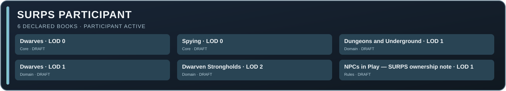

# TheSingularityWorkshop.SingularityUniversalRoleplayingSystem

> A universal ontology and simulation framework for roleplaying worlds, entities, stories, and experiences.

<!-- SURPS:PARTICIPATION:START -->

<!-- SURPS:PARTICIPATION:END -->

## 1. Overview

The Singularity Universal Roleplaying System (SURPS) is the shared foundation for describing and experiencing worlds. It is not tied to one genre, game, ruleset, setting, or medium. It aims to make entities, attributes, capabilities, behavior, interactions, environments, and narrative consequences composable and reusable.

**SURPS is fully playable as a tabletop roleplaying system.** Its sourcebooks must explain complete human procedures that work with paper, pencil, character sheets, dice or another agreed resolution method, and conversation. No application, internet connection, registry, or digital runtime is required. Digital experiences may automate and visualize those same rules, but the tabletop rules remain understandable and usable on their own.

The source books are human-readable expressions of that system. They should explain the underlying concepts while demonstrating them through living diagrams, interactive examples, and simulations.

Start with the [Player and Editor Manual](docs/player-and-editor-manual.md), [Theory: tabletop campaign composition](docs/Theory/tabletop-campaign-composition.md), and [Theory: roleplaying history](docs/Theory/history-of-roleplaying-games.md).

## 2. Architecture

SURPS owns the roleplaying ontology: what entities are, what properties and capabilities they possess, how behavior is represented, and how rules are expressed. It does not absorb the responsibilities of the ecosystem that supports it.

- **FSM_API** — state and transition foundations.
- **Physics** — physical laws and interactions.
- **GrammarAi / ProtocolAi** — structured language and communication concepts.
- **GUI / GUI.SVG** — presentation, interfaces, and living illustrations.
- **StoryBuilder** — narrative construction.
- **FSM_Dungeon** — dungeon environments and their environmental behavior.
- **FSM_COS / FSM_Foundry** — composition and execution of experiences.\n- **Gauntlet** — integrated adversarial proving ground and evidence-producing campaign harness for MicroBundles and SURPS-enabled experiences.

See [Architecture](docs/architecture.md) for the initial responsibility boundaries.

Repository-specific agent work is governed by the root [AgentOnboarding.md](AgentOnboarding.md). CiAi is used as a read-only CI evidence and admission capability; it does not own SURPS ontology or authorize changes. The [CiAi evidence workflow](.github/workflows/ciai-evidence.yml) observes exact-commit Pages evidence.

## 3. Source Books

Books are modular, versionable source material rather than isolated documents. Each book declares its scope, LOD, assumptions, and relationship to CORE and other books. **LOD communicates detail; campaign selection and declared scope determine which books apply.** A higher number does not silently override another book.

See [Source Books](books/README.md), [SURPS Rulebooks](rulebooks.md), and [Tabletop Campaign Composition](docs/Theory/tabletop-campaign-composition.md). The first executable composition is `SurpsRulebookDungeonsAndUnderground`, which wraps the authoritative FSM_Dungeon environment MicroBundle.

## 4. Living Documentation

Illustrations should teach, not merely decorate. SVGs can expose anatomy, state transitions, movement, forces, equipment, environments, and cause-and-effect. Where useful, diagrams will animate or respond to user interaction while remaining accessible and understandable as static illustrations.

The first site is a lightweight static publication surface. The SVG examples are authored assets, not screenshots or video substitutes.

For cross-repository contributors, use the canonical [Workshop Documentation Standard](https://github.com/TrentBest/TheSingularityWorkshop.FSM_COS/blob/development/DOCUMENTATION_STANDARD.md), which now defines SURPS enrollment, sourcebook/cover requirements, generated README badges, and Gauntlet conformance. The [SURPS publication and graphics adoption notes](docs/repository-publication-and-graphics-standard.md) provide domain-specific context and are subordinate to the shared standard.

The book-specific [Rulebook Identity, Titles, and Covers standard](docs/rulebook-identity-and-covers.md) remains authoritative for descriptors, title pages, covers, and LOD badges.

## 5. Development

- `master` represents the last released, published state.
- `development` is the active source branch.
- Work is developed and validated on `development`; release synchronization to `master` is a deliberate step.
- GitHub Pages is deployed from the repository's `docs/` directory by GitHub Actions.
- No package or publication release is implied by documentation deployment.

Start with the [SURPS Workshop site](https://trentbest.github.io/TheSingularityWorkshop.SingularityUniversalRoleplayingSystem/).
