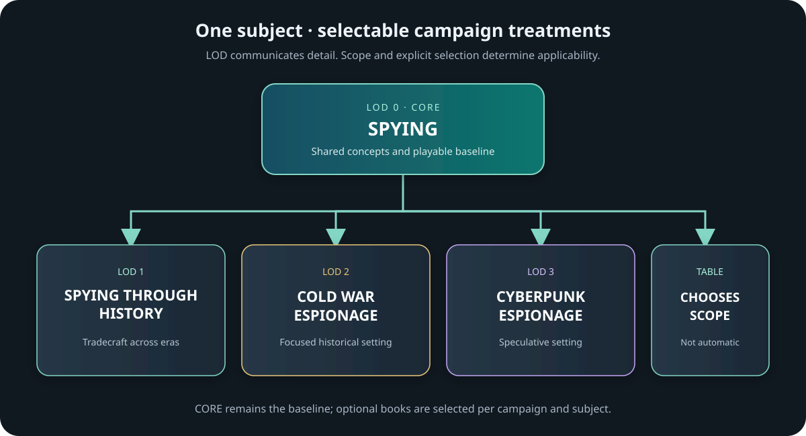

# Tabletop Campaign Composition and Rulebook Selection

This chapter defines how a group builds a SURPS campaign using books at the table. It is intentionally usable without software. The digital editor should eventually present the same choices and preserve the same decisions.

## 1. Begin with the table, not the application

A group needs players and a game master/referee (the group may distribute or rotate referee duties), a shared premise and campaign scope, character and relevant entity records, SURPS CORE, any optional sourcebooks the group chooses, paper and pencils, a shared campaign record, and dice/cards/tables or another agreed uncertainty-resolution method when needed.

The group should agree on its social contract, tone, boundaries, referee authority, and how disagreements or house rulings are recorded. A digital client can help coordinate these things, but it is not required.

## 2. What LOD means—and what it does not mean

LOD is a label for a rulebook's level of detail or specialization. It helps a reader understand how deep or focused a book is. It does not, by itself, tell the table which book wins a conflict.

The campaign chooses applicable books explicitly. Each book declares its subject, scope, assumptions, and relationship to CORE and other books. Two books can have different LOD numbers because they address different scopes, not because one is a newer version of the other.

- CORE is the shared foundation and fallback.
- Optional books are lenses selected for the campaign or a particular subject.
- A book may extend a rule, specialize it for a setting, replace a named procedure, or offer an alternative.
- The group records the selection and any explicit overrides before play.
- If selected books disagree about the same situation, the referee follows the campaign's declared choice or asks the group to decide and records the ruling.

## 3. Worked example: a family of spying rulebooks

Imagine the group wants an espionage campaign. The subject exists in CORE, but the group can choose additional books to give it a particular character.

### CORE / LOD 0 — Spying

The first runnable version is [CORE Spying](../books/core-spying.md), with [printable character, referee, and campaign sheets](../books/core-spying-play-sheets.md). It is a first tabletop playtest draft, not a finalized universal character engine.

CORE provides the common vocabulary and a playable baseline: secrecy, observation, concealment, information, sources, evidence, detection, suspicion, exposure, trust, risk, intent, preparation, access, action, opposition, and consequence. It distinguishes what a character knows, suspects, claims, and can prove.

A referee can run a simple spying scene using only these concepts and the general CORE resolution procedure.

### LOD 1 — Spying Through History

This book adds broad tradecraft, intelligence organizations, historical methods, and changing technology across eras: couriers, dead drops, codes, surveillance, recruitment, counterintelligence, and the influence of communications, transport, law, institutions, and technology.

### LOD 2 — Cold War Espionage

This focused historical campaign sourcebook covers US–Soviet rivalry, period agencies, counterintelligence, proxy operations, diplomatic constraints, era-appropriate equipment and communications, and the risks of compromised identities, double agents, and escalation.

The campaign selects this book because it is playing in that setting. It is not automatically loaded just because it has LOD 2.

### LOD 3 — Cyberpunk Espionage

This speculative setting specialization covers corporate intelligence, network intrusion, pervasive sensors, data brokerage, surveillance infrastructure, identity manipulation, synthetic media, autonomous systems, and digital countermeasures.

A cyberpunk campaign selects this book instead of the Cold War book for its setting. It is not a mandatory upgrade to Cold War rules.

### Example campaign choices

| Campaign | Selected books | What the group gets |
|---|---|---|
| Generic intrigue | CORE | A complete, setting-neutral spying game |
| Historical survey | CORE + LOD 1 | General rules plus tradecraft across periods |
| Cold War campaign | CORE + selected LOD 1 chapters + LOD 2 | Historical grounding and focused period procedures |
| Cyberpunk campaign | CORE + selected LOD 1 chapters + LOD 3 | General tradecraft interpreted through speculative technology |

The table can use fewer books than shown. Optional chapters are only in force when the group chooses them and the book permits modular use.

## 4. A repeatable campaign setup procedure

Before the first session:

1. **Describe the campaign.** Write down genre, era, location, tone, expected themes, and boundaries.
2. **Start with CORE.** CORE supplies the shared terms and default procedures.
3. **Choose sourcebooks.** Select books that match the campaign. Do not choose a book merely because its LOD number is higher.
4. **Assign scope.** Note which book governs which subjects, settings, subsystems, or procedures.
5. **Record explicit overrides.** If a book replaces or changes a CORE procedure, write down exactly what changes and where it applies.
6. **Resolve overlaps.** If selected books conflict, choose a rule before play or record a referee ruling when the situation arises.
7. **Prepare player aids.** Copy the character fields, tables, procedures, and summaries needed at the table.
8. **Keep a campaign record.** Track selected books and versions, house rules, rulings, and unresolved questions.

A one-page campaign sheet can be as simple as:

| Field | Campaign record |
|---|---|
| Campaign title / premise | |
| Genre / era / location | |
| CORE version | |
| Selected rulebooks and LOD | |
| Scope assigned to each book | |
| Explicit replacements / variants | |
| Conflict-resolution convention | |
| House rulings and date/session | |
| Optional procedures not in use | |

## 5. At the table: resolving a rule

1. The player states the character's intent in ordinary language.
2. The referee establishes the situation, target, known facts, and relevant constraints.
3. The table identifies the selected rulebook and procedure for that scope.
4. The referee checks the character's capabilities, training, equipment, condition, and available information.
5. The group resolves uncertainty using the stated procedure or a recorded ruling.
6. The referee describes the outcome, including partial success, failure, cost, interruption, and changed circumstances.
7. The group updates character and campaign records.

If no selected book covers the situation, CORE is the fallback. If CORE does not define a specific answer, the referee makes a transparent ruling, records it, and may later propose a sourcebook clarification.

## 6. What the digital editor should mirror

A digital campaign editor should not decide the rules by silently sorting books by LOD. It should let the editor enable or disable SURPS for this experience; select CORE and optional rulebooks; see each book's LOD, version, scope, assumptions, and declared relationships; assign books to campaign scopes; see explicit replacements, variants, and conflicts; select a conflict policy or require a human ruling; and export or print a campaign sheet and player-facing references.

When SURPS is disabled, the experience does not need SURPS rulebook discovery. FSM_API, FSM_COS, and FSM_Foundry remain independently usable.

## 7. Offline equivalence

A group must be able to take the sourcebooks and campaign sheet away from the computer and continue playing. No essential rule may exist only in a hidden registry, API, database, online service, or UI.

Digital automation may perform calculations, track time and state, reveal applicable references, coordinate remote participants, or render a living picture of the world. The written procedure remains the authoritative human-readable explanation of what the rule means.

## Design status

This chapter establishes editorial and tabletop behavior. It does not claim that the SURPS registry, campaign editor, conflict resolver, or machine-readable rulebook descriptors already implement these workflows. Those APIs remain design targets until validated with the domain rulebook owners.
