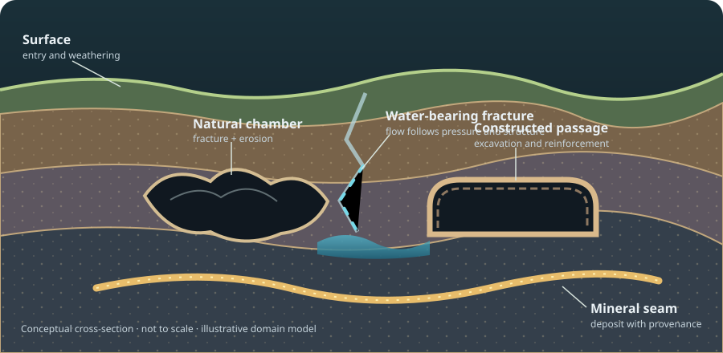

# SURPS Source Books

SURPS sourcebooks are living, human-readable knowledge collections. Each book explains a domain, links to its authoritative implementation, distinguishes rules from current capabilities, and uses accessible living illustrations where motion clarifies a relationship.

## Available core books

### Spying — LOD 0

A setting-neutral, tabletop-playable foundation for secrecy, observation, evidence, infiltration, influence, counterintelligence, exposure, and consequences. First playtest draft; two six-sided dice and paper are sufficient.

[Read CORE Spying](core-spying.md) · [Printable play sheets](core-spying-play-sheets.md) · [Book descriptor](core-spying.book.json)

## Available domain books

### Dungeons and Underground

The underground as a causal world: formation, construction, topology, geology, materials, environmental conditions, hazards, inhabitants, traversal, observation, and world authoring.

[Read Dungeons and Underground](dungeons-and-underground.md)

## NPC domain ownership

The general people, residents, and NPC ontology is owned by [Singularity City — Nonplayer Characters, LOD 1](https://github.com/TrentBest/TheSingularityWorkshop.SingularityCity/blob/development/docs/books/nonplayer-characters.md). SURPS consumes that domain for tabletop character portrayal, encounters, campaigns, and play procedures; it does not own the general NPC/resident ontology.

Specialist domains extend the shared model at higher LOD. For example, [Singularity Laboratories — Laboratory NPCs, LOD 2](https://github.com/TrentBest/TheSingularityWorkshop.SingularityLaboratories/blob/development/docs/books/laboratory-npcs.md) defines laboratory-specific staffing and participants.

<figure>
  
  <figcaption>A place has layers of formation, use, and change.</figcaption>
</figure>

## Editorial principles

- Explain concepts before prescribing implementation.
- Include concrete examples from multiple genres and settings.
- Distinguish universal mechanics from optional setting conventions.
- Link every important concept to its canonical definition.
- Use living SVGs when motion or interaction teaches more effectively than a static image.
- Keep accessible text descriptions and reduced-motion behavior available.
- Label design targets honestly; a diagram is not proof of implementation.
- Keep every sourcebook aligned with its domain owner and cross-domain contracts.

## Chapter template

A chapter should normally contain:

1. The question or problem being explained.
2. A clear conceptual model and vocabulary.
3. A worked example.
4. A living illustration or interactive demonstration where it adds value.
5. Cross-references, implementation notes, and further exploration.

## Planned shared sourcebooks

These remain working titles and scopes, not finalized commitments:

1. **The World Model** — worlds, environments, time, space, and history.
2. **The Entity Compendium** — identity, attributes, capabilities, composition, and relationships.
3. **Behavior & Agency** — perception, motivation, state, decision-making, and action.
4. **Interaction & Consequence** — events, conflict, cooperation, damage, change, and causality.
5. **The Game Master's Workshop** — composing encounters, scenarios, campaigns, and experiences.
6. **The Living Atlas** — worked examples, bestiary entries, locations, factions, and world-building patterns.

The books should emerge from a validated shared ontology. We should not prematurely write a large rule system and then force the ecosystem to conform to it.
