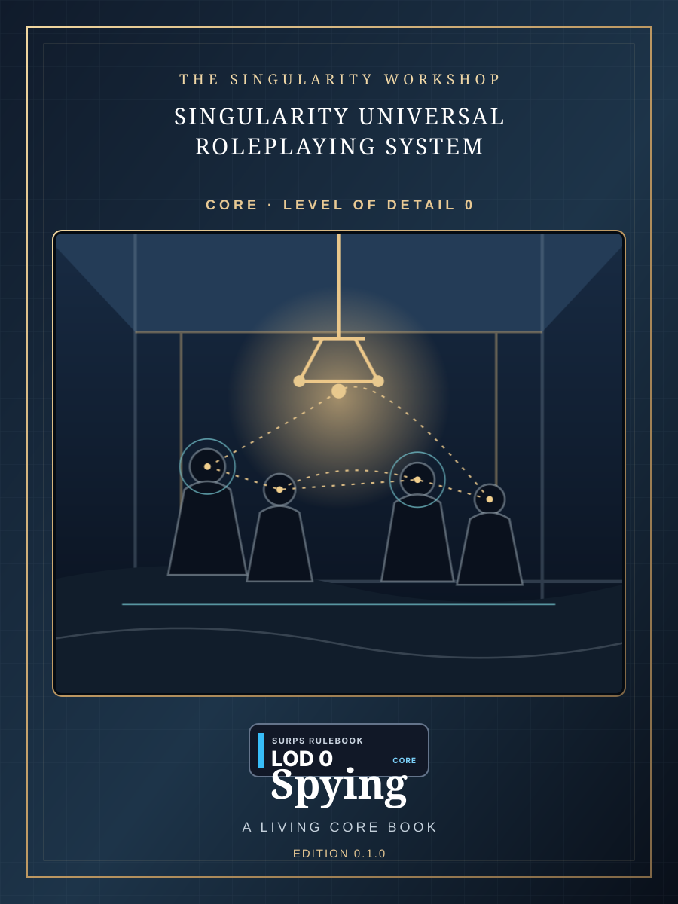

# Singularity Universal Roleplaying System - Core - LOD 0 - Spying

[Book identity descriptor](core-spying.book.json) · [Identity and cover standard](../rulebook-identity-and-covers.md)

**CORE sourcebook module · LOD 0 · Status: first tabletop playtest draft**

> Information is not the same as truth. Access is not the same as control. A successful spy does not necessarily get away unseen.

This module is a first playable tabletop slice of the setting-neutral SURPS CORE spying domain. It is designed to run with paper, pencil, two six-sided dice, and a referee. It does not require an application, internet connection, registry, or digital runtime.

The procedures below are deliberately small and explicit so they can be tested at a table before being promoted into a wider CORE resolution system. They are not a claim that a universal SURPS character engine or digital resolver is already implemented.

## 1. What spying means in CORE

Spying is the deliberate acquisition, interpretation, protection, or transfer of information that another person or organization may wish to conceal.

The core loop is:

1. Establish what is actually true in the world.
2. Establish what the character wants to learn, alter, protect, or communicate.
3. Identify access, preparation, capabilities, equipment, and opposition.
4. Resolve uncertain actions.
5. Record what the character observes, infers, proves, and reports separately.
6. Advance time and the reactions of people or systems affected by the action.

CORE spying is setting-neutral. A village messenger, a court informant, a wartime intelligence officer, and a cyberpunk corporate infiltrator all use the same foundational questions. Their tools, institutions, risks, and available procedures differ by selected sourcebook.

## 2. The referee's information ledger

Before play, the referee privately records important facts. For each fact, track:

| Field | Meaning |
|---|---|
| Fact | What is actually true |
| Source | Who or what knows it directly |
| Evidence | What could support or contradict it |
| Access | How a character might encounter it |
| Exposure | What changes if the fact is discovered or shared |

Players record their character's information separately:

- **Observed:** directly perceived.
- **Inferred:** a conclusion drawn from observations; may be wrong.
- **Claimed:** something another source said.
- **Verified:** supported by evidence the campaign accepts as sufficient.
- **Reported:** information transmitted to a recipient.

A character does not automatically know a referee's world facts. Two characters may hold different reports. A false report remains false even when sincerely believed.

## 3. Character record

Create a spy with the following fields. Ratings are small, descriptive playtest values, not a universal SURPS attribute schema.

**Approaches** rate broad ways of acting:

| Approach | Rating | Typical use |
|---|---:|---|
| Observe | 0–3 | Notice details, watch routines, detect inconsistencies |
| Deceive | 0–3 | Maintain a cover, misdirect, conceal intent |
| Infiltrate | 0–3 | Gain access, move unnoticed, bypass ordinary barriers |
| Analyze | 0–3 | Interpret evidence, connect facts, test a hypothesis |
| Influence | 0–3 | Recruit, persuade, negotiate, build trust |
| Operate | 0–3 | Use tools, communications, codes, or technical systems |

Distribute **8 points** among the six approaches. No approach may begin above 3. A rating of 0 means no particular training; it does not mean the character is incapable of trying.

Also record:

- Name, role, appearance, and cover identity.
- One useful contact and one obligation or vulnerability.
- One item of ordinary equipment.
- One personal objective.
- One pressure: a person, deadline, debt, fear, or competing loyalty.
- Current condition and any campaign-specific notes.

A referee may add a relevant capability or constraint from a selected rulebook, but should not double-count the same advantage.

## 4. The CORE uncertainty procedure

When an action has a meaningful uncertain outcome, use this procedure:

1. **Intent:** the player says what the character wants to achieve, not merely which skill to roll.
2. **Method:** the player describes how the character attempts it.
3. **Risk:** the referee states what can go wrong and what is at stake.
4. **Approach:** choose the one approach that best describes the method.
5. **Difficulty:** the referee sets a target number from 7 (routine under pressure) to 13 (extremely difficult but possible).
6. **Roll:** roll 2d6 and add the approach rating.
7. **Outcome:** compare the total to the target.

| Result | Outcome |
|---|---|
| Total is target + 3 or more | Strong success: achieve the intent and gain a useful extra benefit or reduce exposure |
| Total meets or exceeds target | Success: achieve the stated intent |
| Total is target - 1 or -2 | Mixed result: make progress, but accept a cost, delay, complication, or increased exposure |
| Total is target - 3 or less | Miss: the intent is not achieved; the situation changes and the referee advances a relevant pressure |

A natural 2 or 12 is not an automatic failure or success. The total and the fictional circumstances determine the result.

**Do not roll when the outcome is already certain.** If the character has time, access, and no meaningful opposition, simply establish the result. A roll is for uncertainty with consequences, not for every sentence or movement.

### Setting difficulty

| Target | Guidance |
|---:|---|
| 7 | Routine, with some pressure |
| 9 | Demanding; a capable person can reasonably attempt it |
| 11 | Difficult; preparation or a useful advantage matters |
| 13 | Extreme; several favorable circumstances may be needed |

The referee should explain the relevant obstacle, not hide difficulty behind arbitrary numbers. If the player changes the method or improves the circumstances, reassess before rolling.

## 5. Preparation, assets, and assistance

Preparation should change the situation, not become a second invisible skill score.

A useful asset can do one of the following, when its fictional use is justified:

- lower the target by 2;
- remove a specific obstacle;
- provide access to a person, place, or record;
- protect against one named consequence;
- create a credible alternative route if the first attempt fails.

A single action receives at most one target reduction from preparation or assets. Multiple helpers can contribute, but each must have a plausible role. Assistance does not make an impossible method possible.

The referee should state what an asset can and cannot accomplish before the roll. An item does not grant universal permission to bypass a challenge.

## 6. Time, exposure, and pressure

Use **one action interval** whenever a meaningful spying action consumes time. The referee chooses the interval appropriate to the scene and records it before the first roll: for example, one minute during a tense search, ten minutes during a guarded reception, or one hour during a surveillance shift.

A scene has three optional clocks, each with four boxes:

- **Opportunity:** time before the target leaves, a meeting ends, or access closes.
- **Suspicion:** how close observers are to recognizing hostile or unusual activity.
- **Response:** how close an opposing person or organization is to taking consequential action.

Draw four boxes for each clock. Mark boxes only when the fiction warrants it. A mixed result may mark one box on a relevant clock; a miss may mark one or two. A strong success may prevent a mark or clear one if the described action plausibly does so. At four boxes, resolve the clock's stated consequence.

A clock is a referee aid, not a hidden punishment meter. Tell players what signs their characters can perceive: a guard changes position, a contact stops answering, a door is locked, or a meeting is moved. Do not reveal facts their characters could not know.

When time is paused for player discussion, no action interval passes unless the group agrees otherwise. In continuous-time play, the referee announces a decision window and advances the scene when it expires. The same underlying clocks work in either style.

## 7. Opposition and counterintelligence

Opposition is made of people, procedures, and systems with limited knowledge and resources. Give each opposing actor:

- what they want to protect or discover;
- what they currently know;
- what evidence they have;
- what access and authority they possess;
- what they are watching;
- what event would cause them to escalate.

Opposition does not know a character's intent merely because the player rolled. It reacts to observable traces, reports, mistakes, and established intelligence.

A counterintelligence action uses the same uncertainty procedure. The referee identifies the evidence or behavior being examined and the opposing actor's actual access to it. Do not grant omniscience to an organization because it is the antagonist.

## 8. Consequences and recovery

A spying consequence should change the situation in a way that follows from the method and opposition. Examples include a lost opportunity, a compromised contact, a damaged cover, a misleading report, an exposed route, a new obligation, or an adversary becoming alert.

Record persistent changes. Do not erase a consequence simply because the scene ended. A contact who has been endangered may refuse future meetings; a compromised identity may require a new cover; a false report may misdirect an entire operation until corrected.

Recovery requires an action and a plausible opportunity: rebuild trust, replace equipment, verify a report, establish a new route, or wait for attention to move elsewhere. The referee should state the time and risk involved.

## 9. Worked mission: the missing ledger

**Premise:** In a small river town, a clerk named Mara has copied a ledger showing that the grain stores are being diverted. She plans to hand the copy to a trusted courier before dawn. The characters are asked to identify the recipient and obtain proof without exposing Mara.

### Referee facts (keep hidden until discovered)

- The ledger copy is inside a blue oilcloth folder.
- Mara's recipient is the millwright, who meets her at the old ferry landing.
- The town watch has noticed that someone has been asking about storehouse deliveries, but does not know who.
- A second clerk is diverting grain and has paid a watch sergeant to report unusual activity.
- The courier meeting is moved if the watch is alerted before midnight.

### Scene clocks

- Opportunity: four boxes until the ferry landing meeting is moved.
- Suspicion: four boxes until the watch begins questioning named people.
- Response: four boxes until the corrupt clerk learns the ledger is at risk.

### Example play

A player says: “I want to learn who Mara trusts, without asking her directly.” The referee establishes that the character can watch the clerk's office from the public market. The approach is Observe; the target is 9. The player rolls 7 and adds Observe 2, for 9: success. The character sees Mara pass a folded note to the millwright but does not yet know what it means.

The player now wants to follow the millwright. The referee says the market is crowded, but the millwright knows the town and may notice a tail. Target 11. The character has arranged a plausible market errand, so the referee lowers the target by 2 to 9. The roll totals 8: a mixed result. The character keeps sight of the millwright, but the millwright changes route and the Suspicion clock advances one box.

The player decides not to approach the ferry landing immediately. Instead, the character asks a contact who repairs boats whether the millwright uses the landing after dark. This is Influence, not Analyze: the method is building cooperation. A success reveals the usual meeting time; a mixed result might reveal it while creating an obligation to the boat repairer.

At the landing, the group must decide whether to observe, intervene, or preserve distance. The referee uses the same procedure and clocks. A successful observation may establish the handoff; it does not automatically prove what is in the folder. The characters still need evidence, a reliable witness, or a legitimate opportunity to inspect the copy.

### What counts as proof?

The group should decide what evidence the campaign accepts before the final scene. A witnessed handoff establishes that two people met and exchanged an object. It does not, by itself, prove the ledger's contents or the grain diversion. Inspecting the copy, comparing it with storehouse records, or obtaining a corroborating witness may establish more.

The mission can succeed in several ways: identify the recipient, secure the ledger, protect Mara, expose the diversion, or preserve the evidence while avoiding public exposure. These are distinct objectives. The referee should not collapse them into one pass/fail result.

## 10. Running the module without software

For a session, copy the character record and three scene clocks onto paper. The referee keeps the hidden fact ledger. Players write down observations, inferences, claims, verified evidence, contacts, and consequences. Roll two six-sided dice when the procedure calls for uncertainty.

If a rule is unclear, the referee makes a transparent ruling, states the consequence, and records it for later review. The group can revise the procedure between sessions, not retroactively to erase an inconvenient result.

## 11. Digital mapping (non-normative)

A future digital experience may represent characters, facts, evidence, clocks, actions, and rulebook selections as structured state. It may calculate totals, advance time, track access, and reveal information to authorized observers. It must preserve the distinctions in this chapter:

- world truth is not player knowledge;
- observation is not inference;
- inference is not proof;
- a report is not necessarily true;
- a clock advances because of recorded events, not because an opaque script wants tension;
- SURPS is opt-in per experience.

No digital API or automated spying simulation is claimed by this playtest module.

## 12. Playtest record

After each session, record:

- which actions triggered rolls unnecessarily;
- whether target numbers felt consistent;
- whether mixed results created interesting choices;
- whether clocks were understandable and fair;
- whether information states remained distinct;
- whether time intervals matched the fiction;
- whether players could continue without a digital aid;
- any ambiguity that required a referee ruling.

The next revision should be based on actual table evidence. This module is a first runnable draft, not a declaration that all CORE mechanics are finalized.

## Further reading

- [Rulebook composition and LOD](../rulebooks.md)
- [Tabletop campaign composition](../Theory/tabletop-campaign-composition.md)
- [Player and Editor Manual](../player-and-editor-manual.md)
- [Rulebook identity, titles, and covers](../rulebook-identity-and-covers.md)
