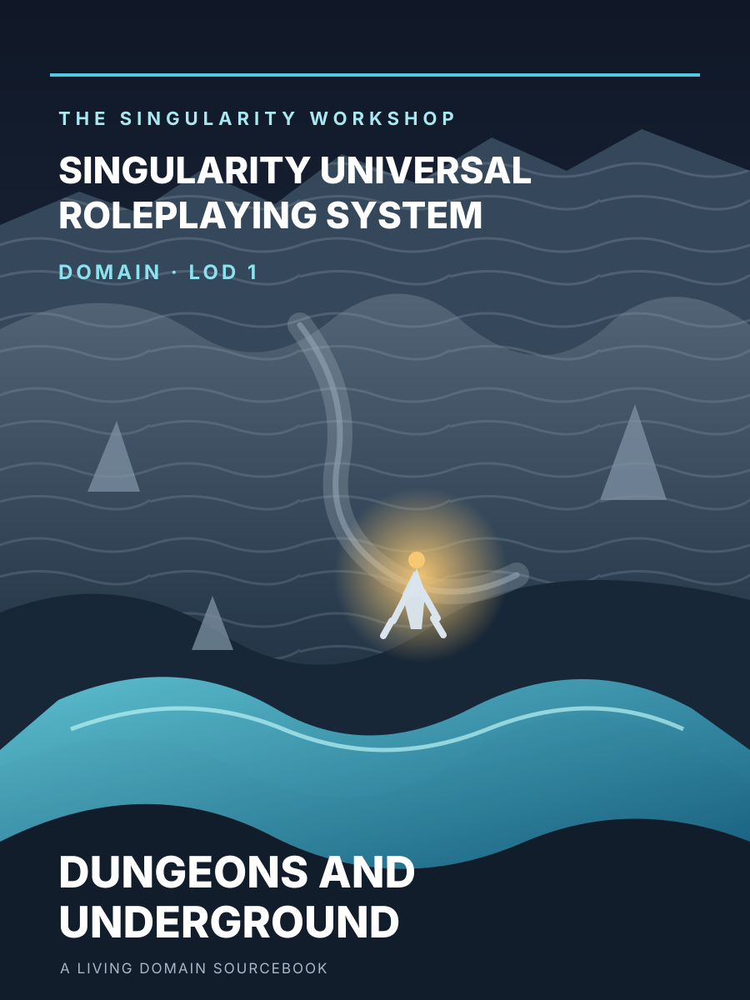
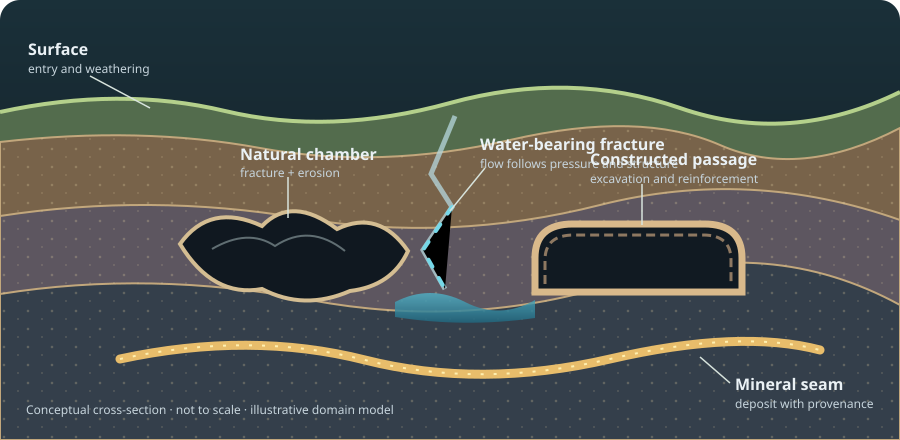
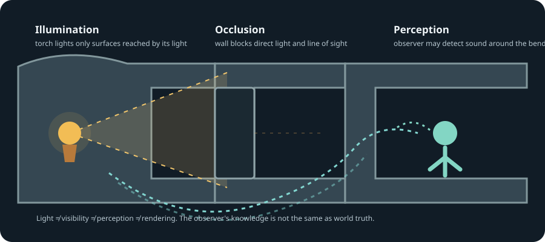

# Singularity Universal Roleplaying System - Domain - LOD 1 - Dungeons and Underground

[Book identity descriptor](dungeons-and-underground.book.json) · [Identity and cover standard](../rulebook-identity-and-covers.md)

**A SURPS domain sourcebook · LOD 1 · Status: living draft grounded in FSM_Dungeon**

> The underground is not a collection of rooms waiting for adventurers. It is a world with a history, a structure, materials, processes, inhabitants, and consequences.

This sourcebook presents the Dungeons and Underground domain through the SURPS rulebook composition `SurpsRulebookDungeonsAndUnderground`. It is the human-readable knowledge layer for the authoritative underground-environment capability exposed by `TheSingularityWorkshop.FSM_Dungeon.MicroBundle`.

It is deliberately broader than a game-master's room-generation guide. It describes the world model, the rules that constrain it, the questions a player or editor can ask, and the connections to other Workshop capabilities. Where a capability is only a design target, that status is stated rather than presented as implemented behavior.

## How to use this book

- **Players and explorers** can use the concepts to understand what an underground place is, what can be discovered, and why conditions matter.
- **World builders and game masters** can use the authoring guidance to create places whose layout, contents, and events have causes.
- **Rulebook authors** can use the domain vocabulary and boundaries when adding higher-LOD books or setting-specific extensions.
- **Tool and AI authors** can use the explicit ownership and evidence distinctions to discover capabilities without treating prose as executable authority.

This is a domain rulebook, not a closed game system. A campaign may add magic, technology, horror, myth, science fiction, or historical conventions through additional rulebooks. Those additions must declare their scope and precedence rather than silently rewriting the shared baseline.

## The living domain at a glance

The underground is simultaneously:

1. **A place** — a spatially connected volume with regions, chambers, passages, barriers, vertical transitions, and boundaries.
2. **A history** — a sequence of formation, excavation, construction, occupation, maintenance, damage, and abandonment.
3. **A material system** — rock, sediment, water, air, minerals, structures, deposits, and manufactured materials in context.
4. **A changing environment** — conditions and processes that evolve over time and affect routes, resources, and safety.
5. **A setting for external entities** — inhabitants, expeditions, societies, machines, and visitors whose ontology and behavior are supplied by SURPS and other rulebooks.
6. **An observable world** — a place whose illumination, visibility, perception, and presentation are related but distinct.

The Dungeon domain supplies environmental truth. A host composes it with other capabilities to create a playable or educational experience.

## 1. What counts as a dungeon?

“Dungeon” is the name of this rulebook domain, not a restriction to artificial stone mazes or fantasy adventure rooms.

It includes natural caves and caverns, fissures, lava tubes, burrows, root systems, mines, quarries, tunnels, excavations, catacombs, crypts, sewers, cisterns, foundations, basements, shelters, constructed undercities, buried facilities, machine-bored passages, ruins, and unfamiliar subterranean structures.

An underground place may be natural, constructed, biological, engineered, mixed, or of unknown origin. These are descriptive possibilities, not a closed enumeration. A place may also change category over time: a natural cavern can become a mine, then a refuge, then a ruin reclaimed by water and roots.

**Rule:** never infer a place's purpose solely from its present appearance. Preserve evidence and provenance. A chamber that looks like a shrine may have been a cistern before it was repurposed; a straight tunnel may be a later service route through an older cave.

## 2. Formation, history, and provenance

Every meaningful feature should be explainable in terms of its origin and subsequent history.

A useful history distinguishes:

- **Formation:** the processes that first created a geological or other natural feature.
- **Excavation:** material removed to create or enlarge a space.
- **Construction:** material assembled or shaped to create a structure.
- **Occupation:** use by an entity, group, or society.
- **Maintenance:** repair, cleaning, reinforcement, drainage, ventilation, and other deliberate care.
- **Alteration:** later additions, conversions, extensions, and repurposing.
- **Damage:** collapse, erosion, fire, flooding, impact, corrosion, or other change.
- **Abandonment and reuse:** a place may lose one purpose and acquire another.

Provenance is not decorative lore. It helps explain geometry, materials, access, hazards, resources, and present condition. A hand-excavated passage, a machine-bored shaft, and a naturally fractured fissure should not become indistinguishable merely because all three connect two regions.

### Authoring rule

When defining a significant chamber, passage, barrier, deposit, or structure, record as much of the following as is known:

- its identity and spatial extent;
- its formation or construction process;
- the material and relevant material properties;
- its approximate sequence or relationship to other events;
- its intended or historical use, if known;
- later changes and current condition;
- the evidence supporting the description;
- uncertainty where the history is incomplete.

Unknown history is valid world content. Do not replace missing evidence with false certainty.

## 3. Spatial topology: adjacency is not access

An underground world is a spatial volume, not merely a list of rooms. Regions and features have positions, extents, elevations, and relationships. Passages, openings, barriers, ladders, stairs, ramps, lifts, bridges, ledges, shafts, pits, chasms, and crawlspaces describe different kinds of spatial structure.

Keep four questions separate:

- **Adjacency:** which regions are spatially near or connected?
- **Traversal:** which routes can a particular entity use, with what capability, effort, equipment, or cost?
- **Visibility:** what is geometrically unobstructed from an observation point?
- **Perception:** what can this observer actually detect with its senses, equipment, knowledge, and current condition?

A sealed door can preserve adjacency while preventing traversal. A chasm can separate two ledges even when they are visible to one another. A hidden passage can exist without being known. A ladder can connect elevations but remain unusable to an entity that lacks the relevant capability.

**Rule:** changing traversal must not erase spatial truth. Destroying a bridge changes the availability of that crossing; it does not delete the chasm, ledges, or their adjacency facts.

Floors and named depths are useful editorial and presentation views. They must not become artificial boundaries that break continuous topology, navigation, or simulation.

## 4. Geology, materials, and deposits

The environment may contain bedrock, strata, sediment, fractures, faults, voids, water-bearing formations, mineral veins, ore bodies, fossils, organic deposits, and materials introduced by construction or occupation.

A material occurrence is more than a label on a map. Its context may include:

- composition or material identity;
- location, extent, thickness, and orientation;
- host formation and surrounding materials;
- condition, alteration, and exposure;
- formation or deposition history;
- accessibility and extraction constraints;
- uncertainty and supporting observations.

Distinguish a general material definition from a particular occurrence in a world. “Limestone” is a material concept; a specific limestone bed exposed in a chamber is a world occurrence with position, extent, history, and condition.

Physics owns the laws and calculations for physical processes. Dungeon records the underground context and the environmental facts needed to ask those questions. The rulebook should identify the relevant Physics capability rather than inventing a second theory of fluid flow, heat, stress, erosion, or transport.

## 5. Water, air, heat, and environmental conditions

Underground conditions are local and causally connected. Water may seep through fractures, collect in low regions, flow through channels, rise behind a blockage, or drain through a lower route. Air may be stagnant, moving, contaminated, oxygen-poor, hot, cold, humid, or otherwise unsuitable. Heat may come from geothermal sources, machinery, combustion, chemical processes, or other world-defined causes.

A condition record describes a state at a place and time. A simulation model advances that state under declared inputs and assumptions. These are not the same thing.

For any environmental model, identify:

1. the state variables and their units;
2. the spatial domain and relevant connections;
3. initial conditions and external inputs;
4. constraints and boundary conditions;
5. the solver or provider responsible for calculating change;
6. the time-step or update policy;
7. validation evidence and known limitations.

The current Dungeon repository includes a first-order hydraulic network proof with head-driven transfer, passage capacity, blockage, inflow, and explicit overflow accounting. It is a deterministic demonstration, not a calibrated flood forecast or a general fluid-dynamics solver. Rulebook prose must preserve that distinction.

## 6. Hazards, resources, and consequences

A hazard is not merely a damage number. It is an environmental condition or feature that can create consequences under particular circumstances.

Examples include unstable ceilings, loose slopes, deep water, fast currents, toxic or oxygen-poor air, extreme heat, cold, falling debris, unstable structures, confined spaces, biological contamination, electrical hazards, and dangerous machinery.

Describe a hazard through its source, location, extent, state, triggering conditions, exposure pathways, possible consequences, and evidence. The actual physical calculation or specialized resolution belongs to the appropriate capability—often Physics—not to a prose-only rule.

Resources are equally contextual. Water, minerals, fuel, building materials, food stores, tools, relics, and salvage may be present, accessible, protected, depleted, contaminated, or renewable. A resource should have provenance and a reason for its location whenever that information is known.

## 7. Inhabitants, societies, and visitors

Dungeon does not define what an inhabitant is, what it wants, or how it decides to act.

SURPS and its selected rulebooks define entities, identity, classification, capabilities, needs, motivations, goals, relationships, culture, social organization, and behavior. Dungeon provides the environment those entities occupy and the environmental facts and consequences relevant to their actions.

This division allows the same entity to move between a cavern, city, wilderness, spacecraft, or laboratory without changing its fundamental ontology. It also allows an underground world to host many creator-defined catalogues without hard-coding species or factions into the environment engine.

Dungeon may record that an entity is present in a region, that a group occupies a settlement, or that an action altered a wall or passage. It must not infer an entity's motive from its location or turn a provisional fixture field into universal behavior.

### Knowledge is not world truth

A tunnel may exist without a scout knowing it. A chamber may be flooded without a distant settlement having received that report. A route may be visible to one observer and unknown to another.

Keep these records distinct:

- authoritative environmental fact;
- observation made by a particular observer;
- interpretation or hypothesis formed from observations;
- report transmitted to another entity;
- knowledge currently held by a recipient.

Perception, communication, memory, and report delivery are capabilities outside the Dungeon environment core. No telepathy is implied by shared access to the same world model.

## 8. Movement, traversal, and Gestures

A route describes environmental possibility; it does not itself move an entity.

A narrow crawlspace, ladder, climbing wall, flooded tunnel, unstable bridge, or steep stair presents different constraints. SURPS describes an entity's capabilities and condition. Gestures can provide the movement procedure appropriate to an interaction: a ladder can offer a climbing gesture, while the entity supplies its own posture, reach, strength, balance, equipment, and current limitations.

The environment can answer questions such as:

- where the ladder begins and ends;
- whether it is intact, wet, obstructed, or damaged;
- what clearance and support geometry exist;
- whether the route is currently open;
- what environmental consequences follow from use.

The movement provider and host resolve the actual action and validate resulting state. A route being present does not guarantee that every entity can traverse it.

## 9. Traps, mechanisms, caches, and treasure

A trap is a constructed or natural mechanism with a causal history, not a surprise damage script. Describe its mechanism, trigger, state, detectability, intended function, builder or origin when known, maintenance, failure modes, and consequences.

Examples include pressure plates, counterweights, falling blocks, darts, pits, flooding gates, alarms, concealed barriers, unstable floors, and defensive mechanisms. These are examples, not a fixed catalogue.

Treasure and caches also belong to the history of a place. Record ownership or historical association where known, why an item was stored or abandoned, its condition and quantity, access requirements, protective measures, and what changes if it is moved, consumed, traded, damaged, or destroyed.

The world generator should place content contextually. A cache may be hidden by its owner, sealed into a burial chamber, carried by a patrol, stored in a maintenance room, or lost during a collapse. The explanation should arise from world history and declared content—not from arbitrary reward placement.

Creator-provided catalogues define the allowed content. The environment may compose and place authorized entries according to their constraints; it should not silently fabricate protected creator-owned assets.

## 10. Darkness, illumination, visibility, and perception

Underground illumination is local. Sources may include flames, carried lamps, machinery, bioluminescence, unusual crystals, reflected daylight, shafts, vents, and other explicitly defined emitters. A chamber with no effective light source must not be treated as though an invisible global sun illuminates it.

Do not collapse these four concepts:

- **Illumination:** light energy reaching a surface or location.
- **Visibility:** geometric or otherwise valid line of sight.
- **Perception:** what an observer can detect through its senses, equipment, adaptation, and condition.
- **Rendering:** how selected facts are presented at a chosen visual fidelity.

A bright chamber does not let an observer see around a bend. A dark passage may be geometrically open but visually imperceptible. Sound, scent, vibration, airflow, heat, and other senses may reveal information that sight cannot.

The Dungeon domain supplies meaningful environmental and material facts. Renderer chooses observer-appropriate computational representation and fidelity. Visualization and host adapters turn that representation into pixels or other sensory output. The renderer must not become the authority for what an entity knows.

## 11. Generation and simulation

A generated place should be reproducible from its declared definition, seed, inputs, and simulation policy. Determinism supports debugging, comparison, authoring, testing, and trustworthy explanations.

Generation and simulation are separate concerns:

- **Definition:** what the creator permits and intends to exist.
- **Generation:** how an initial world is constructed from that definition and seed.
- **Validation:** whether the resulting world satisfies declared invariants.
- **Simulation:** how state changes in response to time and validated events or commands.
- **Observation:** which authoritative facts are selected for a particular observer.
- **Presentation:** how those selected facts are displayed.

Connectivity is an invariant only where the world definition requires it. Additional passages, blocked routes, one-way transitions, and inaccessible spaces are authored topology, not defects to be silently repaired. A validation report should explain which invariant failed and where.

Simulation fidelity can vary by scale: immediate local detail, nearby state, regional summaries, and distant event-driven updates. This is a scheduling and modeling choice, not permission to create contradictory worlds. When detail is expanded, it must be derived from authoritative state and recorded events.

## 12. Authoring an underground experience

A robust authoring sequence is:

1. **Declare the premise.** Why does this place exist, and what experience or question should it support?
2. **Choose an origin.** Natural, excavated, constructed, biological, engineered, mixed, or unknown.
3. **Establish spatial structure.** Define regions, chambers, passages, vertical features, barriers, and important boundaries.
4. **Record provenance.** Explain formation, use, construction, maintenance, alteration, and damage.
5. **Place materials and conditions.** Add geological context, water, air, heat, resources, and hazards with units and assumptions where relevant.
6. **Compose inhabitants.** Select SURPS entities and catalogues; define their relationships and behavior in their owning rulebooks.
7. **Add interactions.** Identify traversal, Gestures, mechanisms, traps, tools, and other required capabilities.
8. **Define observation.** Specify what different observers can perceive and what visual evidence the experience should reveal.
9. **Validate.** Check spatial invariants, dependencies, content constraints, and reproducibility.
10. **Publish the explanation.** Pair the experience with diagrams, source references, examples, and known limitations.

A good scenario can answer “why is this here?” at multiple scales: why the place exists, why a passage follows that route, why a group occupies a region, why a hazard is present, and why a discovery matters.

## 13. Cross-domain composition

The rulebook composes capabilities; it does not absorb them.

| Question or capability | Responsible domain |
|---|---|
| What is this underground place, and how is it structured? | FSM_Dungeon |
| How did the geology or construction develop? | FSM_Dungeon, with domain-specific providers where needed |
| What physical result follows from pressure, heat, flow, stress, or impact? | Physics |
| What is an inhabitant, and what does it want or decide? | SURPS and selected ontology/behavior rulebooks |
| What can an observer sense, remember, or report? | Perception, knowledge, and communication capabilities |
| How does an entity execute a climb, crawl, lift, or other movement? | Gestures and movement providers |
| How is an experiment or educational activity defined and conducted? | SingularityLaboratories |
| Which representation is worth computing for this observer and budget? | Renderer |
| How are pixels and visual effects produced? | Visualization / GUI |
| Which capabilities are composed and which state transitions are authoritative? | MicroBundle host / FSM_COS / FSM_Foundry |

Dependencies must be explicit and versioned. Optional capabilities remain optional. A Dungeon-only host must not be forced to load SURPS, Physics, Renderer, or Visualization merely to inspect a deterministic underground world.

## 14. Rules, evidence, and implementation status

This sourcebook distinguishes three kinds of statement:

- **Domain rule:** a normative constraint on how underground facts should be described or interpreted.
- **Implemented capability:** behavior present in the current Dungeon source and supported by tests or runnable proof.
- **Design target:** a planned capability or quality that is not yet demonstrated by implementation.

The current FSM_Dungeon repository contains a deterministic generation foundation, spatial topology, geological world and material models, a first-order hydraulic simulation, and a browser proof. It also contains transitional inhabitant and observer-knowledge concepts that require future ownership cleanup. These are not evidence that a complete roleplaying game, autonomous population simulation, combat system, or high-fidelity underground renderer is finished.

Useful implementation references:

- [FSM_Dungeon repository](https://github.com/TrentBest/FSM_Dungeon/tree/development)
- [Domain architecture](https://github.com/TrentBest/FSM_Dungeon/blob/development/docs/ARCHITECTURE.md)
- [Living world simulation](https://github.com/TrentBest/FSM_Dungeon/blob/development/docs/WORLD_SIMULATION.md)
- [Underground rendering and observation](https://github.com/TrentBest/FSM_Dungeon/blob/development/docs/UNDERGROUND_RENDERING.md)
- [Dungeon source and tests](https://github.com/TrentBest/FSM_Dungeon/tree/development/src)

A claim becomes “implemented” only when the owning repository contains the capability and evidence appropriate to the claim. A diagram may explain a target model, but it is not proof that the runtime already implements it.

## 15. Further volumes and extensions

This LOD 1 book establishes the domain-wide reference. More specific sourcebooks can deepen a declared scope without rewriting the baseline:

- **Caves, Caverns, and Fissures** — natural formation, speleology-inspired structure, water, and cave ecology.
- **Mines, Quarries, and Excavations** — extraction, supports, shafts, machinery, spoil, and operational history.
- **Catacombs, Crypts, and Burial Places** — funerary architecture, memorial practice, tomb construction, and respectful setting-specific conventions.
- **Sewers, Cisterns, and Under-Cities** — water networks, maintenance, civic infrastructure, and urban subsurface spaces.
- **Ruins and Buried Civilizations** — construction phases, reuse, collapse, archaeology, and lost infrastructure.
- **Underground Hazards and Survival** — environmental exposure, route assessment, resources, and rescue.
- **Dungeon Scenario Design** — encounters, expeditions, exploration loops, campaign integration, and authoring patterns.

Each extension should identify its LOD, scope, assumptions, dependencies, provenance, and explicit conflicts with inherited rules. Higher LOD takes precedence only within the applicable scope; unrelated lower-LOD knowledge remains available.

## Glossary

| Term | Meaning |
|---|---|
| Region | A spatially meaningful part of the underground world with an extent and identity. |
| Chamber | An enclosed or partly enclosed space within a region. |
| Passage | A spatial connection or route between areas; its traversability is evaluated separately. |
| Barrier | A feature that obstructs, constrains, or changes movement, visibility, flow, or other interactions. |
| Provenance | The origin, history, and evidence associated with a world fact or feature. |
| Material occurrence | A particular spatial instance of a material, distinct from the general material concept. |
| Condition | A state of the environment at a location and time. |
| Observation | Information detected by an observer; not identical to authoritative world truth. |
| Traversal | The ability and means to move through a route under current constraints. |
| Fidelity | The level of detail used to simulate or represent a world for a particular purpose. |

---

*This is a living sourcebook. As the authoritative Dungeon domain evolves, its concepts, examples, diagrams, and implementation references should evolve with it. The book explains the world; the domain implementation remains the authority for executable environmental behavior.*
