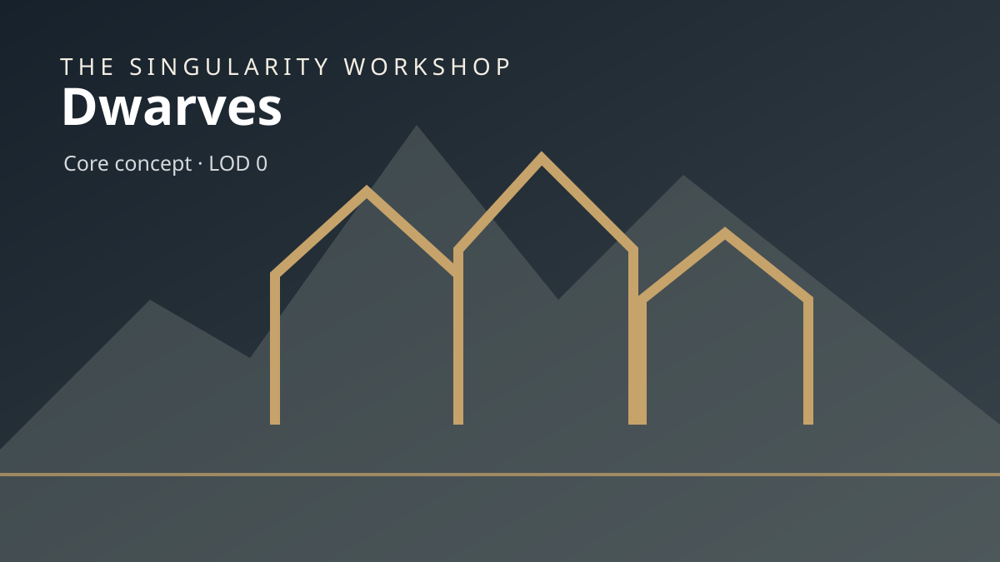

# Singularity Universal Roleplaying System - Core - LOD 0 - Dwarves

**Status:** Core concept entry. This establishes only the minimum world-level concept, not a complete people, culture, encounter, or settlement model.

## Concept

This illustration shows the LOD 0 boundary: existence is a world fact; population, culture, stronghold, and individual detail may remain undisclosed until an experience selects or authors them.

Dwarves are a people known to exist in some worlds. A setting may place a dwarven population beneath a mountain, within a distant range, across a neighboring territory, or among other communities. Their existence can be part of the world's truth without making them present in every scene—or even encountered during a particular experience.

At LOD 0, the world may record only that a dwarven people and one or more dwarven communities exist. Their exact population, internal organization, customs, stronghold layout, and individual inhabitants may remain undefined or deliberately undisclosed.

## What LOD 0 permits

- A world reference that dwarves exist.
- A coarse geographic association, such as "a dwarven community beneath the northern mountain".
- Rumors, trade references, historical mentions, or a known route toward their region.
- No requirement that a player meet a dwarf, visit a settlement, or learn private details.

## What LOD 0 does not define

It does not define universal anatomy, personality, language, culture, social structure, occupations, equipment, or stronghold architecture. Those belong to higher-detail sourcebooks and setting-specific authorship. Do not infer that every dwarf is a miner, warrior, smith, or member of one uniform culture.

## Escalation of detail

- **LOD 1 — Dwarves:** use when dwarves become relevant as people: encounters, market activity, relationships, trade, or cultural context.
- **LOD 2 — Dwarven Strongholds:** use when the experience enters or meaningfully operates within a stronghold, its institutions, districts, and underground infrastructure.
- **LOD 3+ — Individual dwarven cities:** select or author a specific settlement with its own identity, history, inhabitants, and persistent state.

A higher LOD adds detail; it does not invalidate lower-LOD facts. A nearby town can host dwarven merchants while the stronghold remains a distant, unvisited fact.
