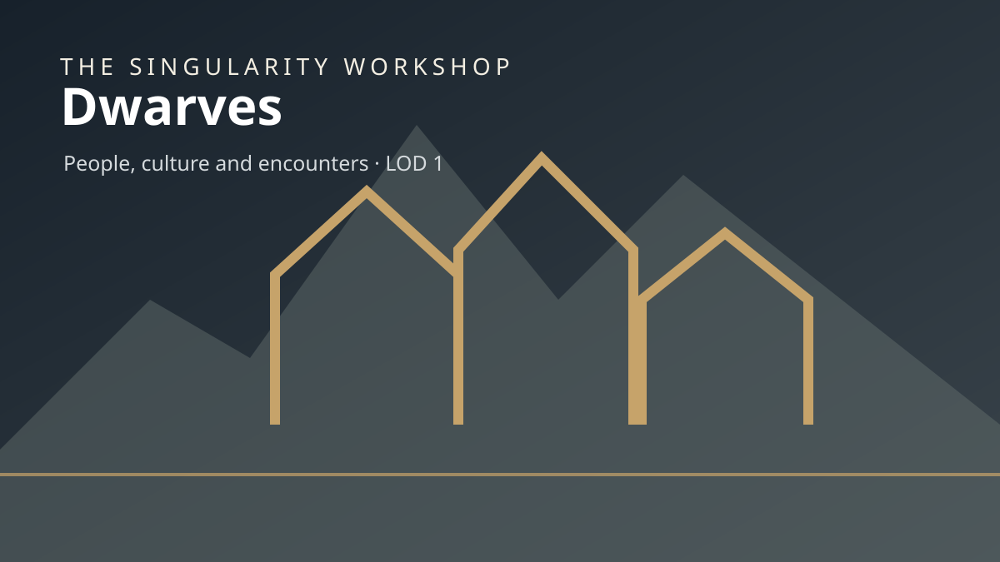

# Singularity Universal Roleplaying System - Domain - LOD 1 - Dwarves

**Status:** General domain sourcebook. It describes dwarves as a people and provides reusable cultural and encounter context. It does not define the interior of a particular stronghold.

## 1. Scope and relationship to core

The LOD 0 core concept establishes that dwarves exist. This book supplies the next layer when they become relevant to an experience: who they may be, how varied their communities can be, how they participate in wider society, and what can reasonably be encountered without entering their homeland.

Dwarves are not a single occupation, temperament, political faction, or architectural style. Each setting authors its own lineages, histories, cultures, bodies, languages, beliefs, and social conventions. The examples here are design vocabulary, not mandatory universal traits.

## 2. People and variation

A setting may define physical characteristics, life stages, family structures, accessibility needs, senses, environmental adaptations, and differences among populations. Do not assume all dwarves share identical bodies or abilities. Avoid treating cultural practices as biological inevitabilities.

Dwarven communities can include artisans, farmers, merchants, healers, teachers, administrators, performers, diplomats, scholars, travelers, caregivers, children, elders, and people whose lives are not organized around a formal occupation. A character can hold multiple roles and change them over time.

## 3. Culture and community

Culture is learned, shared, contested, and changed. Relevant dimensions may include language and dialect, food, clothing, music, craft traditions, storytelling, ceremony, education, law, hospitality, kinship, humor, remembrance, and attitudes toward land or ancestry. Neighboring communities may disagree sharply while still identifying as dwarves.

A setting should distinguish personal belief, family custom, guild practice, civic law, religious institution, and political doctrine. No one individual should be treated as a perfect representative of an entire people.

## 4. Dwarves in the wider world

A dwarf encountered in a surface town need not be an emissary of a stronghold. They may be a local resident, seasonal worker, merchant, courier, student, craftsperson, traveler, refugee, diplomat, or tourist. Their immediate relationships and reasons for being present should be authored at the level needed by the scene.

### Market example

A town near a known dwarven stronghold may have a regular dwarven presence in its market: merchants selling tools or specialty goods, buyers seeking food and textiles, couriers, craftspeople, and visitors. City owns the market, its stalls, residents, visitors, schedules, and civic relationships. The general Dwarves book informs cultural context and character portrayal. The stronghold itself can remain offstage and undisclosed.

A market scene must not silently instantiate the stronghold's complete population, internal politics, maps, defenses, or production system. Trade links can point toward a distant community without opening that community as an explorable location.

## 5. Organizations, craft, and trade

Possible organizations include households, guilds, cooperatives, merchant houses, schools, civic councils, religious communities, mutual-aid societies, and military or protective services. These are setting-specific structures. Membership, occupation, qualification, authority, and personal identity remain distinct.

Trade should have provenance and reciprocal context: goods, origin, maker, quality, quantity, ownership, transport, price formation, obligations, and relationships. A dwarven merchant's inventory is not a direct window into a stronghold's total stock or industrial capacity.

## 6. Encounter and knowledge boundaries

Use only details justified by the current experience. A visitor may know that a stronghold exists but not its entrance, layout, defenses, population, or current events. Rumors can be incomplete or wrong. A character's knowledge is not omniscient world truth.

Escalate to the Strongholds book when the scene requires interior geography, institutional life, underground infrastructure, access control, district operations, or stronghold-scale events. Selecting a specific city requires its own setting/settlement record.

## 7. Ownership and composition

| Concern | Owner |
|---|---|
| General resident/visitor/NPC identity, occupations, schedules, institutions, population fidelity | [Singularity City — Nonplayer Characters, LOD 1](https://github.com/TrentBest/TheSingularityWorkshop.SingularityCity/blob/development/docs/books/nonplayer-characters.md) |
| Dwarven people, setting variation, cultural and encounter context | SURPS — this book |
| Stronghold districts, underground topology, construction history | [FSM_Dungeon](https://github.com/TrentBest/FSM_Dungeon) with SURPS stronghold content |
| Mountain terrain and physical substrate | [Physics](https://github.com/TrentBest/TheSingularityWorkshop.Physics) |
| Specific dwarven city identity and civic geography | Singularity City plus the selected settlement's owning domains |

SURPS tabletop rules may portray these entities and encounters, but the general resident ontology remains City-owned. Specialist sourcebooks extend the shared domain rather than creating duplicate people.

## 8. Higher-detail books

- [Dwarven Strongholds — LOD 2](dwarven-mountain-fortress.md): the internal environment and society of a stronghold.
- Individual dwarven cities at LOD 3+: authored or selected settlements with their own histories, geography, institutions, and inhabitants.
- [Dungeons and Underground — LOD 1](dungeons-and-underground.md): general underground environments, whether or not dwarves inhabit them.
