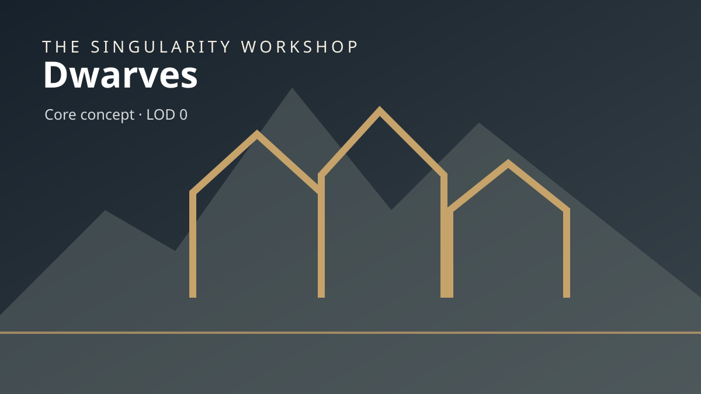
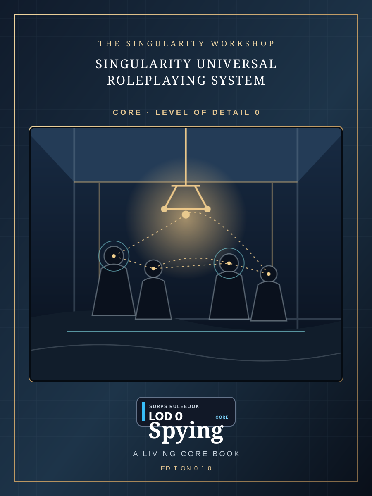
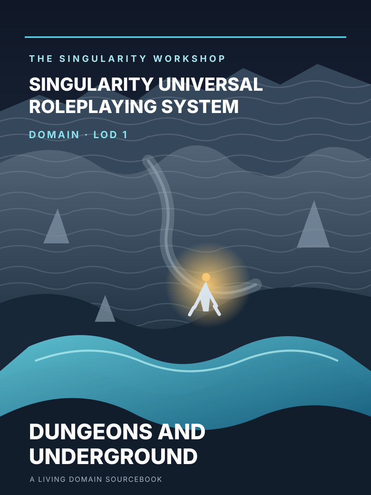
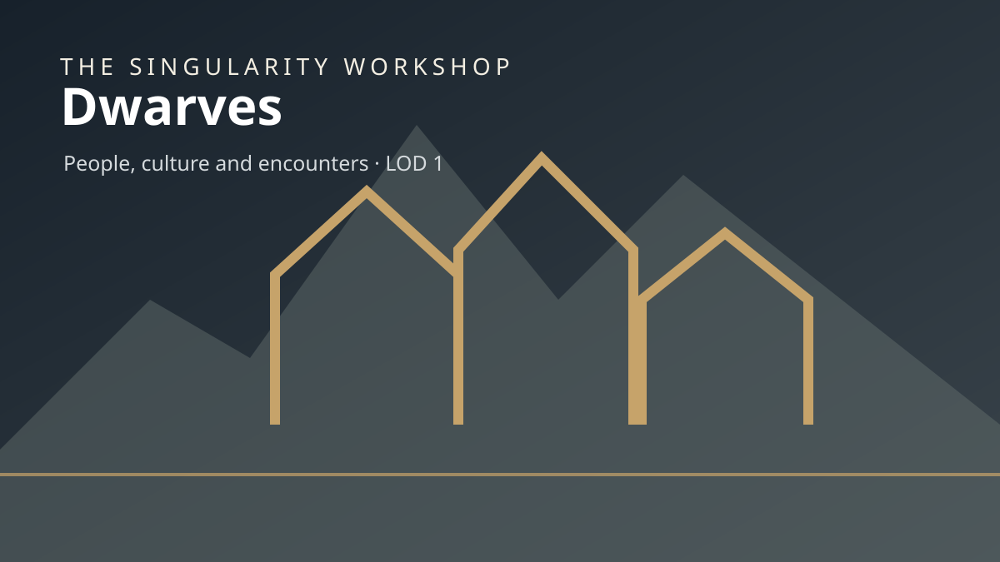
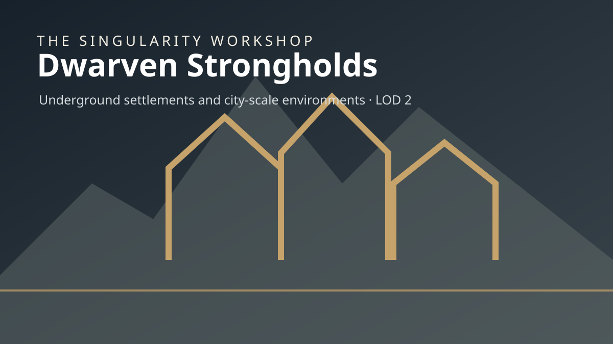
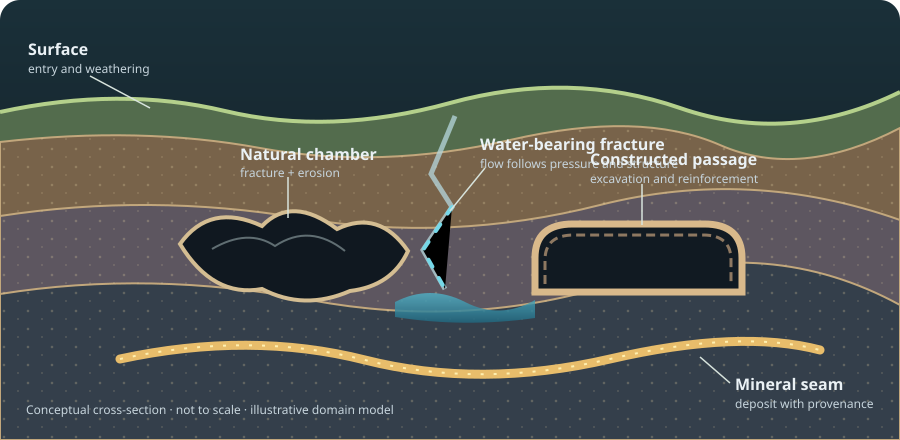

# Singularity Universal Roleplaying System - Source Books

SURPS sourcebooks are living, human-readable knowledge collections. Each book explains a domain, links to its authoritative implementation, distinguishes rules from current capabilities, and uses accessible living illustrations where motion clarifies a relationship.

## Core concepts — LOD 0

### Dwarves

Descriptor: [dwarves-core-concept.book.json](dwarves-core-concept.book.json)

Dwarves are known to exist in the world, but their population, culture, stronghold, and individual inhabitants may remain undefined or undisclosed.

[Read Dwarves — Core Concept](dwarves-core-concept.md)

### Spying

Descriptor: [core-spying.book.json](core-spying.book.json)

A first playable tabletop module for setting-neutral espionage. Includes a character approach record, 2d6 uncertainty procedure, evidence ledger, time and pressure clocks, counterintelligence, and a worked mission.

[Read CORE Spying](core-spying.md) · [Printable play sheets](core-spying-play-sheets.md)

## Domain books — LOD 1

### Dungeons and Underground

Descriptor: [dungeons-and-underground.book.json](dungeons-and-underground.book.json)

The underground as a causal world: formation, construction, topology, geology, materials, environmental conditions, hazards, inhabitants, traversal, observation, and world authoring.

[Read Dungeons and Underground](dungeons-and-underground.md)

### Dwarves

Descriptor: [dwarves.book.json](dwarves.book.json)

A general people-and-culture sourcebook: variation, families, crafts, organizations, trade, visitors, encounters, and dwarves participating in wider communities. This is the correct level for a town-market encounter where dwarves are present but their stronghold remains offstage.

[Read Dwarves](dwarves.md)

## Stronghold books — LOD 2

### Dwarven Strongholds

Descriptor: [dwarven-mountain-fortress.book.json](dwarven-mountain-fortress.book.json)

The internal anatomy and life of a stronghold: districts, access, governance, infrastructure, underground topology, material logistics, construction history, and observer knowledge.

[Read Dwarven Strongholds](dwarven-mountain-fortress.md) · [FSM_Dungeon scenario contract](https://github.com/TrentBest/FSM_Dungeon/blob/development/docs/DWARVEN_MOUNTAIN_FORTRESS.md) · [Physics mountain-volume brief](https://github.com/TrentBest/TheSingularityWorkshop.Physics/blob/development/docs/GEOLOGY_MOUNTAIN_VOLUME_AND_FORTRESS.md)

## Cross-domain ownership

The general people/resident/NPC ontology is owned by [Singularity City — Nonplayer Characters, LOD 1](https://github.com/TrentBest/TheSingularityWorkshop.SingularityCity/blob/development/docs/books/nonplayer-characters.md). SURPS consumes that domain for tabletop portrayal, encounters, campaigns, and play procedures. Dwarven culture and setting-specific portrayal belong to the Dwarves book; stronghold environments compose FSM_Dungeon and Physics rather than duplicating their authoritative models.

Specialist domains extend shared models at higher LOD. For example, [Singularity Laboratories — Laboratory NPCs, LOD 2](https://github.com/TrentBest/TheSingularityWorkshop.SingularityLaboratories/blob/development/docs/books/laboratory-npcs.md) defines laboratory-specific staffing and participants.

<figure>
  
  <figcaption>A place has layers of formation, use, and change.</figcaption>
</figure>

## Editorial principles

- Explain concepts before prescribing implementation.
- Include concrete examples from multiple genres and settings.
- Distinguish universal mechanics from optional setting conventions.
- Link every important concept to its canonical definition.
- Use living SVGs when motion or interaction teaches more effectively than a static illustration.
- Keep accessible text descriptions and reduced-motion behavior available.
- Label design targets honestly; a diagram is not proof of implementation.
- Keep every sourcebook aligned with its domain owner and cross-domain contracts.

## Chapter template

A chapter should normally contain:

1. The question or problem being explained.
2. A clear conceptual model and vocabulary.
3. A worked example.
4. A living illustration or interactive demonstration where it adds value.
5. Cross-references, implementation notes, and further exploration.

## Planned shared sourcebooks

These remain working titles and scopes, not finalized commitments:

1. **The World Model** — worlds, environments, time, space, and history.
2. **The Entity Compendium** — identity, attributes, capabilities, composition, and relationships.
3. **Behavior & Agency** — perception, motivation, state, decision-making, and action.
4. **Interaction & Consequence** — events, conflict, cooperation, damage, change, and causality.
5. **The Game Master's Workshop** — composing encounters, scenarios, campaigns, and experiences.
6. **The Living Atlas** — worked examples, bestiary entries, locations, factions, and world-building patterns.

The books should emerge from a validated shared ontology. We should not prematurely write a large rule system and then force the ecosystem to conform to it.

## Identity and cover standard

New books must follow the [canonical identity and cover contract](../rulebook-identity-and-covers.md). The descriptor is authoritative; the catalogue title and cover must agree with it.
