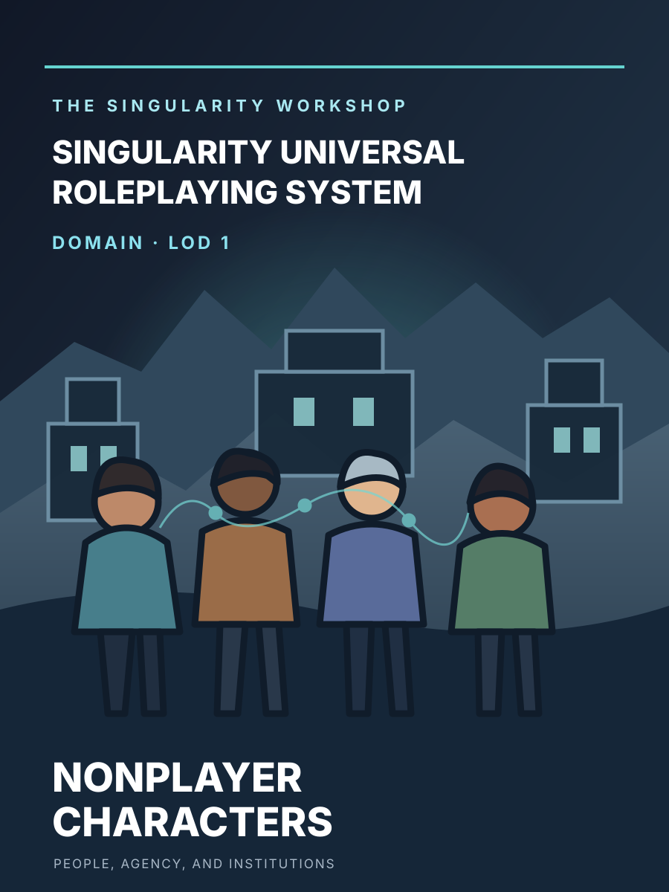

# Nonplayer Characters — people who make worlds function

**Status:** LOD 1 shared domain sourcebook. This is a domain framework and tabletop design target; it is not a claim that a complete NPC simulation, scheduler, dialogue engine, or population simulator is implemented.

Nonplayer Characters (NPCs) are not decorative crowds, quest dispensers, or interchangeable workers. They are people in the world who have their own identities, capabilities, knowledge, needs, relationships, histories, goals, choices, and consequences. A world becomes believable when its institutions and communities are made of people whose lives continue beyond the player's immediate attention.

This book defines the shared people-and-agency concepts that other SURPS books and domain systems can compose. It is intended for every setting: a village, a laboratory, a starship, a military installation, a school, a hospital, a shop, a city, a dungeon, or an entire civilization.

## 1. What makes someone an NPC?

An NPC is a character whose decisions and actions are not directly authored by a player at the moment of play. The referee, scenario, simulation, or host may present and operate that character. The label describes a play relationship, not a lesser kind of person.

An NPC may be:
- a named individual with a long history and independent goals;
- a temporary visitor, customer, patient, student, witness, or contractor;
- a staff member filling one or more institutional positions;
- a member of a family, crew, guild, faction, community, or organization;
- one member of a population represented at an appropriate level of detail;
- a synthetic, robotic, alien, fantastical, or otherwise nonhuman character where the setting supports it.

A player may later take control of an NPC, and an NPC may become a player character. The world identity should not need to be discarded when the play-control relationship changes.

## 2. Person, role, position, and assignment are different things

These concepts must not be collapsed:

| Concept | Meaning | Example |
|---|---|---|
| Character / person | The continuing individual and their identity | Mara Venn |
| Capability | What the character can reliably do | Operate a spectrometer |
| Qualification | Evidence that a capability meets a declared standard | Current instrument certification |
| Position / billet | A place an institution needs filled | Laboratory Safety Officer |
| Role | A set of expected responsibilities in a context | Safety review and incident coordination |
| Assignment | A time-bounded relationship between a person and a position or responsibility | Mara assigned to Lab A through the end of the term |
| Membership | Belonging to a group or institution | Member of the laboratory staff |
| Authority | A recognized right to make a decision in a defined context | Approve a laboratory's local operating procedure |
| Authorization | A trusted system decision permitting a particular action | Host grants access to a restricted dataset |

A person can hold several positions, and one position can have several people across shifts. A position can be vacant. An assignment can expire, be suspended, or be revoked without erasing the person or the historical record.

An assignment does not prove qualification. A qualification does not automatically confer authority. A fictional rank or job title does not grant digital access. Authentication and authorization remain the responsibility of the trusted host and security system.

## 3. The character record

A useful character record is assembled from separable, versionable facets. A scenario can use only the detail it needs.

### Identity and continuity
- stable character identity, names, aliases, pronouns where relevant, and known identifiers;
- origin, lineage or species, age or life stage where meaningful to the setting;
- appearance and distinguishing features;
- current status, location, and continuity across scenes or campaigns;
- public identity versus facts that are secret, disputed, or unknown.

### Capabilities and limitations
- skills, practiced abilities, aptitudes, and experience;
- physical, cognitive, social, technical, and supernatural capabilities where applicable;
- equipment and resources actually available to the character;
- qualifications, training, certifications, and their validity;
- limitations, injuries, disabilities, accessibility needs, and accommodations;
- confidence and evidence: a claimed skill is not necessarily a demonstrated skill.

### Knowledge and belief
- what the character knows, suspects, misunderstands, or has never encountered;
- source, time, and reliability of acquired information;
- private knowledge versus shared or institutionally recorded knowledge;
- memories that may be incomplete, mistaken, concealed, or changed;
- expertise that is bounded by a field and does not imply universal knowledge.

Knowledge must be perspective-aware. A player-facing description must not reveal facts the character has not learned merely because the simulation stores them.

### Motivation and needs
- goals, priorities, values, fears, obligations, and current concerns;
- physical and social needs appropriate to the setting;
- short-term intent and longer-term aspirations;
- competing motives and trade-offs;
- what could change the character's mind.

Motivation is not a single alignment label. A person can be loyal to a community and disagree with its leader, love a family member and refuse a request, or act courageously in one context and cautiously in another.

### Relationships and social context
- family, friendship, rivalry, mentorship, partnership, and dependency;
- professional relationships and institutional membership;
- trust, reputation, debt, obligation, conflict, and shared history;
- groups, factions, cultures, and communities;
- relationship provenance and the perspective of each participant.

Relationships are not necessarily symmetric. Two people can interpret the same relationship differently.

## 4. Agency and behavior

An NPC should not need a bespoke script for every possible situation. A useful behavior model connects:

**Perception → Interpretation → Motivation → Deliberation → Decision → Action → Consequence → Learning**

This is a conceptual loop, not a claim that every character uses one universal AI algorithm. The detail and autonomy are chosen by the scenario and simulation budget.

- **Perception:** What can this character observe from their location, senses, equipment, and current condition?
- **Interpretation:** What do they believe the observation means, and how certain are they?
- **Motivation:** Which needs, goals, values, and obligations are active?
- **Deliberation:** What options do they recognize, and what constraints matter?
- **Decision:** What do they choose, including refusal, delay, delegation, or inaction?
- **Action:** What can they actually attempt with their capabilities and resources?
- **Consequence:** What changes in the world and in other characters?
- **Learning:** What do they remember, revise, practice, or communicate?

A character may be interrupted, distracted, exhausted, misinformed, incapacitated, or unable to act. The system must distinguish inability, unwillingness, lack of knowledge, lack of permission, and failure of execution.

## 5. Institutions are made of people

Institutions describe purposes, structures, policies, facilities, resources, and positions. NPCs inhabit those structures through explicit memberships and assignments.

Examples:

| Institution | Positions and responsibilities |
|---|---|
| Laboratory | Director, principal investigator, safety officer, instructor, technician, researcher, custodian, learner |
| Military base | Command staff, operations, logistics, medical staff, maintenance, security, training, civilian support |
| Village or city | Mayor, council, administrators, tradespeople, teachers, health workers, emergency services, residents |
| Starship | Command crew, navigation, engineering, science, medical, service crew, passengers |
| School | Head, teachers, support staff, counselors, students, guardians, visitors |
| Hospital | Clinical teams, technicians, administrators, facilities, patients, visitors |
| Shop or market | Owner, manager, staff, suppliers, customers, inspectors |

These are examples, not universal hierarchies. A small settlement may have one person performing several duties; a large institution may have departments, shifts, deputies, contractors, volunteers, and vacancies.

A position definition should describe:
- its purpose and responsibilities;
- required and preferred capabilities or qualifications;
- authority and accountability boundaries;
- reporting, collaboration, and escalation relationships;
- duty schedule, shift coverage, and location;
- resources and equipment needed;
- risk, training, supervision, and accommodation requirements;
- succession, vacancy, handover, and termination procedures.

The institution owns its organizational structure and position requirements. The NPC domain owns the character and their person-level attributes. Assignment connects them without merging their records.

## 6. Staffing, schedules, and continuity

Staffing is more than counting bodies. A functioning institution needs appropriate coverage, competence, handover, rest, supervision, and resilience.

A staffing plan should account for:
- positions required per facility, operation, shift, or event;
- minimum qualifications and required supervision;
- availability, leave, rest, fatigue, and overlapping duties;
- conflicts of interest and incompatible responsibilities;
- emergency coverage and succession;
- vacancies, temporary assignments, contractors, and volunteers;
- onboarding, training, evaluation, reassignment, and offboarding.

A position being filled does not prove that the institution is adequately staffed. A schedule being populated does not prove that a person is available or fit for duty. A character's current state and the institution's current needs must both be evaluated.

For tabletop play, the referee may resolve a small staff roster with a simple duty table and a few named NPCs. For a large city or military installation, populations may be represented by departments, shifts, or aggregates until an individual becomes relevant. Level of detail should expand when decisions, relationships, or consequences require it.

## 7. Populations, crowds, and simulation scale

Not every resident needs a fully simulated biography and continuous decision loop. Use the least detailed representation that preserves the consequences relevant to play.

Possible representation levels:
1. **Aggregate population:** counts, demographics, needs, and broad trends.
2. **Group or team:** shared purpose, capabilities, cohesion, morale, and leadership.
3. **Role-bearing individual:** a person represented because a duty, encounter, or decision matters.
4. **Named character:** persistent identity, relationships, memory, and personal goals.
5. **Foreground character:** detailed moment-to-moment perception, deliberation, dialogue, and action.

These are modeling choices, not character worth. A background aggregate can be expanded into individuals when the story or simulation needs it. Expansion should preserve known population totals and provenance; collapsing individuals into an aggregate should not silently erase consequential history.

## 8. Dialogue, communication, and information flow

Dialogue is an action between people, not merely a text string attached to a character.

A communication event can record participants, medium, time, language, intent, message, audience, delivery, and what each recipient understood. Speaking, listening, reading, broadcasting, writing, signaling, and deliberately withholding information are different actions.

A character may lie, be mistaken, speak indirectly, misunderstand, refuse to answer, or lack a shared language. A message being sent does not prove it was received, believed, or understood. Information can spread through reports, rumor, official channels, observation, records, and social networks.

Communication systems own language and protocol mechanics; NPCs own their knowledge, intent, and interpretation. Hosts own the delivery mechanism and access controls.

## 9. Ethics, safety, and representation

NPCs should not be reduced to stereotypes or treated as disposable props by the underlying model. Cultural, biological, psychological, and social traits must be explicit setting choices with provenance, not assumptions inferred from a name, appearance, species, or job.

A scenario should distinguish:
- character facts from rumors and player assumptions;
- a person's own beliefs from the beliefs of their community;
- authority from moral legitimacy;
- consent from compliance or coercion;
- a fictional security clearance from real digital authorization;
- narrative injury or incapacity from a real-world diagnosis.

When a character is assigned hazardous work, the institution must account for training, protective equipment, supervision, exposure, and the right to refuse or report unsafe conditions. The fictional rules can model consequences without becoming real-world operational instructions for harm.

## 10. Tabletop procedures

The NPC book must work with paper, pencil, conversation, and the table's agreed dice procedure. A compact NPC card can contain:

- identity and current presentation;
- immediate goal and concern;
- two or three defining capabilities;
- relevant limitation or need;
- what they know and how they know it;
- important relationship(s);
- current position, assignment, and availability;
- one likely response and one pressure that could change it.

When a player interacts with an NPC:
1. Establish what the player character can perceive.
2. Determine what the NPC knows and believes about the situation.
3. Identify the NPC's active goal, obligation, and concern.
4. Resolve uncertainty using the campaign's selected CORE procedure.
5. Record meaningful changes to trust, knowledge, resources, relationships, assignments, and world state.

Do not roll for every greeting or routine task. Resolve uncertainty when an outcome is consequential, contested, or genuinely unknown.

## 11. Cross-domain ownership

| Concern | Owner |
|---|---|
| Shared character identity, capabilities, motivation, knowledge, relationships, and agency vocabulary | SURPS / NPC sourcebook |
| Institutional structure, positions, duties, facilities, and staffing requirements | Owning domain (Laboratories, City, military installation, school, etc.) |
| Physical capabilities and physical consequences | Physics |
| Gesture, posture, movement, and embodied action | Gestures / movement providers |
| Language, dialogue structure, and communication protocols | GrammarAi / ProtocolAi and relevant communication providers |
| Persistent memory and information retrieval | Owning memory/data capability |
| Authentication, digital authorization, secrets, and access enforcement | Trusted host/security domain |
| Scheduling and workflow lifecycle | Owning institution and workflow/execution services |
| Presentation and embodiment | Renderer / Visualization / host |

A laboratory can define a Safety Officer position and record that a character is assigned to it. The laboratory's qualification policy determines what evidence is required. The trusted host decides whether the authenticated principal may access a restricted instrument or dataset. These are related decisions, but they are not the same decision.

## 12. Relationship to other sourcebooks

- **CORE** supplies common entity, action, time, and consequence foundations.
- **Behavior & Agency** (planned shared book) should own general behavior theory and reusable agency concepts; this book applies them to characters and institutions.
- **Dungeons and Underground** describes inhabitants in the context of underground environments and settlements.
- **Singularity Laboratories** defines laboratory positions, staff responsibilities, learner participation, and institutional procedures.
- **Singularity City** defines civic offices, services, businesses, public institutions, and residents.
- **Military and security sourcebooks** may define rank structures, command responsibilities, unit organization, and setting-specific procedures. The NPC book supplies the people who occupy those roles; it does not replace those specialized books.
- **Gestures** describes embodied movement and interaction capabilities.

## 13. Implementation boundary and next evidence

The book is the shared conceptual and tabletop source. It does not yet establish a universal NPC CLR model, autonomous decision engine, population simulator, dialogue engine, scheduling service, or identity provider.

Before freezing a shared implementation contract, validate the concepts against several very different consumers:
1. a laboratory with staff, students, guests, and external reviewers;
2. a military installation with command, shifts, specialists, contractors, and civilian support;
3. a small village with overlapping duties and persistent relationships;
4. a starship or expedition with a bounded crew and changing assignments.

The contract should emerge from these cases. Domain repositories should consume or adapt the shared NPC concepts rather than creating incompatible local person models. No owning repository should be forced to adopt an API that has not been reviewed against its actual needs.

## References

- [SURPS sourcebook catalogue](index.md)
- [Rulebook composition and LOD selection](../rulebooks.md)
- [Dungeons and Underground](dungeons-and-underground.md)
- [Dwarven Mountain Fortress case study](dwarven-mountain-fortress.md)
- [Singularity Laboratories](https://github.com/TrentBest/TheSingularityWorkshop.SingularityLaboratories/tree/development)
