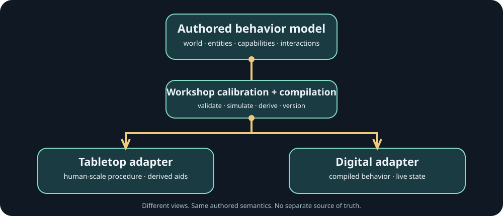
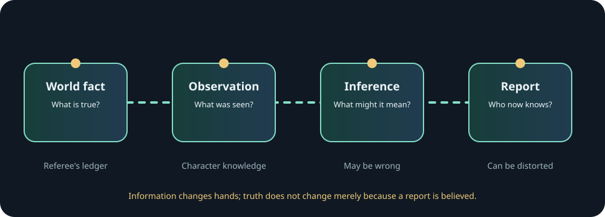

# SURPS
## The Living Game — Core Manual

**A roleplaying system for worlds that behave.**

<badge>Development manuscript · Edition 0.1</badge>

> One world. One underlying model of reality. Many ways to experience it.

---

## A note on this edition

This is the primary game manual and the reader's front door to SURPS. It is written as a book, not as API documentation: introduction, concept, principles, how to play, how to run a world, worked experiences, reference, and appendices.

SURPS is an evolving system. Some parts of its ontology and digital architecture are established; some experiences are playable prototypes; some behavior providers and calibration tools remain under construction. This manual distinguishes those states. It does not present a proposed capability as a finished game mechanic.

The digital experience is the primary direction of SURPS. The tabletop adapter is a deliberate, independently usable expression of the same behavior, both as a tribute to roleplaying's roots and as a low-friction way to introduce the ideas before a digital experience is available. A published tabletop procedure is not a competing ruleset: it is a human-scale projection derived from the underlying behavior model.

**Current playable entry point:** [CORE Spying — first tabletop playtest module](books/core-spying.md) · [Play it in the browser](books/core-spying-play.html) · [Printable play sheets](books/core-spying-play-sheets.md).

---

# Front matter

## Welcome to SURPS

Imagine a world in which a door is not merely a difficulty number, a sword is not merely a damage value, and a journey is not simply a sequence of travel checks.

The door has a material, construction, condition, lock, history, and relationship to the people who built it. The sword has a shape, mass, edge, balance, material, and state. The journey has terrain, weather, distance, supplies, fatigue, companions, danger, and decisions. These things interact.

SURPS is built around that idea: **describe the world, describe what exists within it, describe how things behave, and let consequences emerge from those relationships.**

A player does not need to know every variable. A Game Master should not have to calculate a mountain of numbers. The digital system can evaluate detail that would be unreasonable to track by hand, while presenting people with understandable choices and outcomes. The tabletop view compresses the same behavior into practical procedures.

You are not learning two games. You are learning one way to describe and experience a world.

## How to use this book

- **New players:** begin with *The Big Idea*, *Your Place in the World*, and *Playing an Experience*. Skip implementation details.
- **Game Masters:** read the same chapters, then use *Running the World*, *Building an Experience*, and the deep links to each domain book.
- **Digital creators:** read *The Digital World*, *Behavior and Adapters*, and the Workshop notes. Domain repositories remain authoritative for their own behavior.
- **Tabletop groups:** use the published tabletop adapter and printable aids for the selected books. Do not invent a universal roll where a book has not published one.
- **Researchers and publishers:** use the glossary, provenance, edition, and sourcebook references to understand what is established and what is still being tested.

The online edition is nonlinear. Follow links, open diagrams, inspect examples, and return to the main thread whenever you need it. The chapter order also works as a conventional linear book.

## The promise of this book

By the end, you should understand:

1. What SURPS is trying to make possible.
2. How a world, an entity, a capability, and an interaction fit together.
3. How players express intent and experience consequences.
4. How a Game Master prepares and steers an experience without memorizing an encyclopedia.
5. Why tabletop and digital play are adapters over one behavior model.
6. How books, domains, and experiences compose without becoming one giant monolithic ruleset.

---

# Part I — The big idea

## 1. A world that behaves

Traditional roleplaying often asks a group to translate a situation into a rule: choose a skill, roll dice, compare a number, apply damage, and narrate what happened. This can be enjoyable and useful, but the rule can become more important than the situation it was meant to represent.

SURPS starts one step earlier.

A world contains entities. Entities have properties, capabilities, conditions, relationships, and histories. They exist in environments. They perceive, decide, act, interact, and change. The world responds according to the behavior of the things involved.

A rule is a description of some part of that behavior. It should explain what matters, when it applies, what can change, and what follows. A number is useful when it describes something meaningful; it is not automatically the meaning itself.

<figure>
  
  <figcaption>A settlement is not a collection of disconnected modifiers. Its parts constrain and affect one another.</figcaption>
</figure>

### The living picture

Think of a mountain stronghold. A blocked water channel affects workshops. Workshops stop producing tools. Maintenance falls behind. A lift becomes unreliable. Residents alter routes. Trade changes. A local problem becomes a story because the world carries its consequences forward.

The Game Master can introduce a fault, a shortage, a rumor, or a decision. The world model helps reveal what that change touches. Players see the parts that matter to their characters; the GM can inspect the larger causal picture.

### The central principle

**Describe causes and consequences before choosing the procedure used to represent them.**

A procedure is a useful interface to behavior. It should not erase the behavior.

## 2. One model, multiple experiences

SURPS has one underlying behavior model and multiple adapters.

<figure>
  
  <figcaption>The adapters present the same authored behavior at different levels of detail.</figcaption>
</figure>

### The digital experience

The digital adapter can evaluate many interacting variables: geometry, material, posture, momentum, visibility, sound, time, injury, equipment condition, environmental conditions, and more—when the owning domain actually provides those models.

It can keep detailed state and still show a player a clear result:

- The strike glances off the shield; the defender is pushed back.
- The blow lands hard; the target loses balance and drops what they were holding.
- The impact is catastrophic; armor buckles and the target is incapacitated.

The player experiences the world, not a spreadsheet. The GM can inspect the underlying detail when needed.

### The tabletop experience

The tabletop adapter is a human-scale view. It might use dice, cards, tables, qualitative bands, or a short procedure. Those values are derived during workshop calibration from the same behavior model, using representative scenarios and declared assumptions.

The tabletop view is intentionally less detailed. It preserves the important choices and consequences without asking a person to simulate every physical, social, or environmental variable.

A tabletop procedure must be published with its scope and maturity. If it has not been calibrated from a behavior model, it must say so. A provisional playtest rule is useful; pretending it is derived when it is not is not.

### Workshop calibration

Workshop time is where expensive work belongs. Authors can run thousands of representative cases, compare outcomes, inspect edge conditions, and derive quick procedures. The results become versioned artifacts.

At runtime, the digital experience should load and reuse compiled behavior. It binds current world state to that behavior. It must not reuse an old outcome after the target, equipment, environment, or time has changed.

Read the technical contract: [Behavior Model and Adapters](behavior-and-adapters.md).

## 3. What makes a roleplaying experience?

A roleplaying experience is a shared world in which participants make decisions through characters or other agents, and those decisions change what happens next.

The group agrees on:

- **Premise:** what kind of experience are we entering?
- **Participants:** who plays characters, who facilitates the world, and what is automated?
- **Scope:** which places, subjects, eras, and domains matter?
- **Books:** which rulebooks and sourcebooks govern those subjects?
- **Boundaries:** what themes, content, and procedures are welcome?
- **Persistence:** what is remembered between scenes and sessions?

The experience may be a dungeon expedition, a city life simulation, a political negotiation, a scientific expedition, a war, a mystery, or something that has no familiar genre label.

SURPS does not prescribe one setting or one style of play. It supplies a common way to describe the things that make those experiences possible.

## 4. The vocabulary of a living world

| Concept | Meaning |
|---|---|
| **World** | A connected collection of environments, entities, events, histories, and governing behavior. |
| **Environment** | The circumstances and constraints in which entities exist and interact. |
| **Entity** | Anything represented in the world: person, creature, object, place, organization, or abstract actor. |
| **Identity** | What makes an entity this entity across descriptions and changes. |
| **Attribute** | A meaningful, typed property of an entity or environment. |
| **Capability** | Something an entity can do, provide, or make possible. |
| **Condition** | A current state that changes what an entity can do or how it behaves. |
| **Behavior** | How state, perception, goals, rules, and context produce responses and changes. |
| **Interaction** | An event involving entities and/or their environment. |
| **Consequence** | A change produced by an interaction, including delayed and indirect effects. |
| **Experience** | A selected, composed, playable view of a world and its content. |
| **Rulebook** | A versioned source of concepts, behavior, procedures, assumptions, and scope. |

These definitions are the shared vocabulary, not a claim that every possible entity has already been modeled.

---

# Part II — Being in the world

## 5. Your character is more than a list of scores

A character is an entity with identity, history, properties, capabilities, condition, relationships, and intent.

A character record may include:

- identity and presentation;
- origin, culture, and background when relevant to the selected experience;
- physical or constructed form;
- attributes and capabilities;
- training and experience;
- current conditions and injuries;
- equipment and resources;
- goals, motivations, and fears;
- relationships, affiliations, and reputation;
- history and persistent changes.

A score is a compact clue about behavior, not a substitute for it. A high strength value may suggest the ability to move heavy loads, but the actual result also depends on leverage, footing, fatigue, injury, tools, and the object being moved.

A character is not defined by what they can do at their best. Their current condition matters. So do the environment and the means available to them.

### Character identity and experience progress

Your character definition is not the same thing as a campaign save. The character describes who they are. An experience records what happened in a particular world: discovered places, completed objectives, faction standing, local possessions, and other campaign-specific progress.

A temporary encounter state is different again. It may contain current position, action window, temporary effects, and pending interactions.

Keeping these separate allows one character to participate in multiple experiences without confusing their identity with each world's history.

### Create a character

The central [SURPS Character Studio](character-studio.html) is the current prototype for creating, editing, and exporting characters. It stores records locally in the browser and supports JSON import/export. It is not yet an account service or cross-device cloud save. The draft export is not the final canonical interchange format.

## 6. What a character can do

A capability describes an action or contribution that an entity can provide under some conditions. It may come from anatomy, training, equipment, a relationship, an environmental feature, or a specialized provider.

A person may climb because they have suitable anatomy and training, because a ladder is available, because the wall has handholds, or because another character helps. Those are different contributing capabilities.

The question is not simply, "Do you have Climbing at rank 4?" It is:

- What are you trying to accomplish?
- What capabilities contribute?
- What constraints apply?
- What does the environment provide or prevent?
- What is the cost or risk?
- What changes if the attempt succeeds, partially succeeds, or fails?

A digital experience can resolve those relationships in detail. A tabletop adapter can summarize them into a small number of meaningful factors.

## 7. Intent, action, and consequence

A player begins by describing what their character wants to happen, not by naming a skill or requesting a roll.

A useful declaration has three parts:

1. **Intent:** what outcome are you trying to achieve?
2. **Approach:** how are you attempting it?
3. **Commitment:** what are you willing to risk, spend, expose, or change?

The GM or digital experience identifies the relevant world facts, capabilities, constraints, and possible consequences. If the outcome is already clear, resolve it directly. If meaningful uncertainty remains, use the applicable book's procedure.

The result should answer the situation. It may change position, access, trust, evidence, resources, health, equipment, time, awareness, or the state of the environment. A failed attempt should not automatically mean nothing happens; it may create a cost, reveal information, consume time, or change the opposition's behavior.

### A simple example: opening a stuck door

A character wants to get through a swollen wooden door.

The world model can consider the door's material and condition, its frame, water damage, hinges, tools, the character's leverage and strength, available space, noise, and what waits on the other side.

The outcome is not only "door opened" or "door not opened." Perhaps the door opens quietly with the right tool. Perhaps it opens loudly and damages the frame. Perhaps the character makes progress but loses time and attracts attention. Perhaps the door cannot be opened from this side without changing the situation.

The digital experience can evaluate more of the underlying details. The tabletop adapter presents a concise choice and consequence.

## 8. Conflict is a change in the world

Combat is one kind of conflict, not the universal template for every interaction.

A conflict can be physical, social, political, investigative, environmental, economic, or psychological. Each has different meaningful state and consequences.

A physical confrontation may involve distance, posture, footing, reach, momentum, protection, pain, fatigue, and the surrounding environment. A negotiation may involve trust, incentives, leverage, credibility, relationships, and information. An investigation may involve access, observations, evidence quality, inference, and time.

SURPS should not force all of these into one generic damage score.

### Harm and impact

The system aims to describe what an event does to the target and the world. A numeric measure may exist inside a domain model, but a player-facing description should communicate the meaningful effect.

For example:

- **Negligible:** no meaningful impairment; perhaps a warning or minor disturbance.
- **Limited:** discomfort, a small loss of position, a minor resource cost.
- **Substantial:** a meaningful injury, lost opportunity, broken equipment, or forced retreat.
- **Severe:** incapacitation, major structural failure, lasting impairment, or a decisive change in the scene.
- **Catastrophic:** life-threatening or world-changing consequences, where the domain and fiction support them.

These are illustrative language bands, not a universal damage table. A book must define the effects appropriate to its domain and setting.

---

# Part III — Playing an experience

## 9. The rhythm of play

SURPS supports both deliberate turns and continuously advancing worlds.

A session commonly moves through:

1. **Establish:** show the current situation, relevant facts, and immediate pressures.
2. **Choose:** participants declare intent and approach.
3. **Resolve:** the experience evaluates clear actions directly and uncertain actions through the applicable procedure.
4. **Reveal:** communicate what characters perceive and what the world has changed.
5. **Persist:** record lasting consequences and carry the world forward.

A digital experience may pause for a decision, advance in real time, or combine both. A tabletop group can use rounds, turns, clocks, or conversational pacing as appropriate to its published adapter.

Time matters because the world does not stand still merely because a player is thinking. A scene can have deadlines, moving actors, environmental change, or competing opportunities. The experience should make the decision window understandable and fair.

## 10. Choosing books for an experience

SURPS is modular. An experience selects the books that apply to its world and subject matter.

- CORE provides the shared vocabulary and baseline.
- Domain books provide specialized behavior and knowledge.
- Setting books establish assumptions about a particular world, era, or genre.
- Experience books define a particular playable activity, campaign, or scenario.

**LOD means level of detail. It does not automatically mean priority.** A higher LOD does not silently replace another book. The experience declares which books apply to which subjects and what to do if two selected books disagree.

The [SURPS Master Rulebook Map](rulebook-backlog/index.md) shows the broader catalogue and its owning repositories. The [sourcebook catalogue](books/README.md) links to available books. Only books marked as available should be treated as published content; planned entries are not promises of implemented mechanics.

## 11. The player view

The player view should answer:

- What does my character know or perceive?
- What can I attempt?
- What are my meaningful choices?
- What might I risk or gain?
- What changed as a result?

It should not expose every internal variable, hidden fact, evaluator trace, or Game Master control. Players need enough information to make informed decisions without being required to understand the implementation.

A player may inspect more detail when the experience allows it, but the default view should support immersion and agency.

## 12. The Game Master view

The Game Master view is an operational workshop, not merely a larger character sheet.

It should help the GM:

- inspect the true state of the world separately from character knowledge;
- reveal, conceal, or author facts;
- change conditions and see likely consequences;
- create or modify entities, locations, factions, and events;
- adjust encounter pressure without rewriting the underlying rules;
- inspect the causes of a surprising result;
- pause, branch, rewind, or replay a scenario where the host supports it;
- see what is implemented, simulated, authored, or only proposed.

The GM should be able to steer the story with minimal cognitive friction. The system carries the detail; the GM makes the meaningful decisions.

---

# Part IV — The digital world

## 13. Digital-first, not digital-only

SURPS is designed for interactive digital worlds. It can use persistent state, detailed domain simulation, live visualization, procedural generation, and machine-assisted evaluation. It should make complexity available without making complexity the player's burden.

The digital system must remain legible. A simulation that produces a number without explaining the relevant causes is not enough. A useful result shows what mattered, what changed, and what the participant can do next.

The presentation layer is an adapter too. A textual view, a 2D scene, a 3D world, a VR experience, and a paper record can present the same underlying state in different ways.

## 14. Workshop, compilation, and runtime

The intended lifecycle is:

1. Domain authors define behavior, assumptions, units, and valid operating conditions.
2. Validation checks identities, references, types, constraints, and provenance.
3. Workshop simulations explore representative and boundary scenarios.
4. Calibration derives tabletop procedures and reference aids.
5. Compilation creates versioned digital behavior artifacts.
6. The experience loads and warms those artifacts.
7. Runtime binds current actor, target, equipment, environment, and time state.
8. The system evaluates the interaction and records the result and provenance.

The runtime should cache immutable compiled behavior, not a final result that depends on mutable state. If a target moves or a character becomes injured, the current state must be rebound before evaluation.

This is an engineering target, not a claim that the full compiler and cache pipeline is already complete. See [Behavior Model and Adapters](behavior-and-adapters.md) for the current contract and implementation gaps.

## 15. Domain ownership

SURPS is not the owner of every simulation it composes.

| Domain | Authority |
|---|---|
| Roleplaying ontology, character composition, shared book contracts | SURPS |
| Physical laws, forces, material behavior, physical simulation | Physics |
| Underground topology and environmental behavior | FSM_Dungeon |
| Civic geography, residents, institutions, destinations | SingularityCity |
| Accounts, ledgers, markets, transactions | Economy |
| Posture, gesture, locomotion, temporal motion | Gestures |
| Experience composition and execution | FSM_COS / FSM_Execution |
| Presentation and interactive UI | GUI and related presentation tools |

A SURPS experience connects these domains. It does not duplicate their truth or claim a provider that has not been implemented.

---

# Part V — The Game Master's workshop

## 16. Prepare a world, not a pile of encounters

Begin with a premise and the questions the experience should explore. Establish the places, actors, resources, institutions, pressures, and events that make the world move.

Then select the domain books and providers that actually apply. A small, coherent world is better than an enormous catalogue of disconnected mechanics.

For each important element, ask:

- What is it?
- What does it want or what purpose does it serve?
- What can it do?
- What constrains it?
- What does it know?
- What can affect it?
- What changes when it acts?
- What evidence would show that the model is working?

## 17. Reveal information deliberately

The world may have facts that the characters do not know. A character may observe something, infer a cause, hear a claim, verify evidence, or report information to another person. These are not interchangeable.

The GM view should preserve the distinction between world truth and character knowledge. Revealing a fact is an intentional experience decision, not an accidental consequence of opening a data panel.

## 18. Change the story without breaking the world

A GM can introduce a new event, alter an actor's intention, change weather, close a route, reveal a secret, or make a faction act. The system should help identify the consequences of that intervention.

The goal is not to prevent improvisation. It is to make improvisation more powerful by showing relationships the GM might otherwise have to remember.

---

# Part VI — First experience: CORE Spying

## 19. Information, access, and consequence

Spying is a useful first demonstration because it is not primarily about physical damage. It is about what is true, who knows it, how information is acquired, what can be inferred, and what happens when someone acts on incomplete knowledge.

The current [CORE Spying book](books/core-spying.md) introduces six approaches: Observe, Deceive, Infiltrate, Analyze, Influence, and Operate. It distinguishes world facts from observations, inferences, claims, verification, and reports. Opportunity, Suspicion, and Response clocks help the GM track pressures that evolve during a scene.

<figure>
  
  <figcaption>Information changes as it moves between people. A report is not automatically truth.</figcaption>
</figure>

Play the [Embassy Reception scene](books/core-spying-play.html) or use the [printable play sheets](books/core-spying-play-sheets.md). This is a first tabletop playtest module. Its current 2d6 procedure is provisional and has not yet been derived from a calibrated digital spying evaluator.

The point of this example is not to establish 2d6 as the universal SURPS mechanic. It is to demonstrate how a domain book can teach its subject, provide a runnable experience, and expose its maturity honestly.

---

# Part VII — The book library

## 20. How the books fit together

The primary manual teaches the shared system. Sourcebooks deepen a subject. Setting books describe a world or context. Experience books make a particular scenario playable.

A book should normally contain:

1. What this subject is and why it matters.
2. A big-picture living model.
3. How to use the book.
4. A concise player path.
5. A deep Game Master/Workshop path.
6. Concepts broken into their parts.
7. Rules shown in action with worked examples.
8. Tabletop and digital adapter views.
9. Data, edge cases, references, glossary, provenance, and maturity.

See the [Living Rulebook and Experience Standard](living-rulebook-standard.md) for the full editorial contract.

## 21. Reading paths

- **Start playing:** [CORE Spying](books/core-spying.md).
- **Explore the world model:** [Living System Guide](system-guide.html).
- **Create a character:** [Character Studio](character-studio.html).
- **Explore underground worlds:** [Dungeons and Underground](books/dungeons-and-underground.md).
- **Browse the available catalogue:** [SURPS Source Books](books/README.md).
- **See the complete map:** [SURPS Master Rulebook Map](rulebook-backlog/index.md).
- **Understand the digital architecture:** [Behavior Model and Adapters](behavior-and-adapters.md).

---

# Appendices

## Appendix A — Current maturity

SURPS is an active development system. The current state should be read precisely:

- The central ontology and modular book composition are documented and evolving.
- The Character Studio is a browser-local prototype; canonical portable character serialization and cloud identity are not yet complete.
- CORE Spying is a playable tabletop and browser playtest module; its dice values remain provisional.
- The fireball workshop in the Living System Guide is a teaching prototype, not a validated Physics-backed spell engine.
- The production workshop calibration and compiled digital behavior pipeline remain engineering work.
- Participating domain repositories are adopting the common book and living-picture standard; adoption does not mean every domain has a completed digital adapter.

## Appendix B — Glossary

**Adapter:** A presentation and interaction form that exposes the same underlying behavior for a particular audience or medium.

**Behavior model:** The authored description of how entities and environments respond to state, context, constraints, and interaction.

**Compiled behavior package:** A versioned set of immutable artifacts produced for efficient digital execution.

**Experience:** A composed playable world, scenario, campaign, or activity.

**Game Master (GM):** The person or system responsible for presenting the world, adjudicating or authoring its responses, and managing information and pacing. The role may be shared or partly automated.

**Level of Detail (LOD):** A label for the declared depth or specialization of a book. It is not an automatic priority rule.

**Provider:** A domain-owned capability or evaluator that supplies behavior to a composed experience.

**Workshop calibration:** Authoring-time simulation and analysis used to derive human-scale procedures and validate compiled behavior.

## Appendix C — Publication and provenance

This manuscript is maintained in the SURPS repository. Each release should identify its edition, publication date, source commit, included book versions, and maturity status. Domain books retain their own ownership and version histories.

Before commercial or print publication, the editorial pass must verify original prose and illustrations, third-party asset licenses, sourcebook permissions, trademarks, attribution, accessibility, and consistency between the print edition and the live digital edition. A print edition should include a stable edition identifier and a route to errata and updates.

## Appendix D — Further reading

- [Living Rulebook and Experience Standard](living-rulebook-standard.md)
- [Behavior Model and Adapters](behavior-and-adapters.md)
- [SURPS Rulebooks and Domain Microbundles](rulebooks.md)
- [Player and Editor Manual — technical companion](player-and-editor-manual.md)
- [Repository Participation Standard](repository-participation.md)
- [Repository Adoption Tracker](participating-repository-adoption.md)

---

*SURPS — The Living Game. A world worth exploring is a world whose details matter.*
